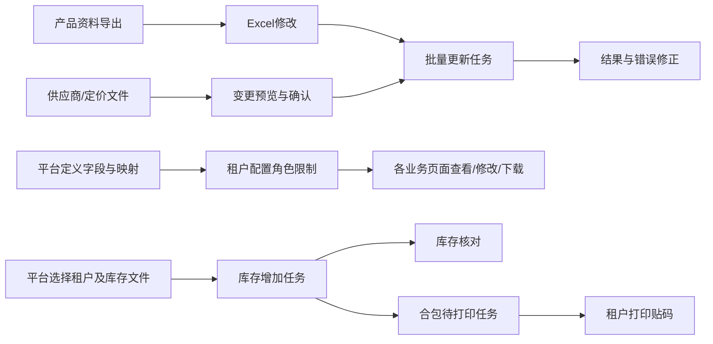

# WMS 网站前端升级设计改造方案

> 版本：V1.1（补齐逐接口交互、用户文案与原站风格约束）  
> 日期：2026-10-27  
> 范围依据：`nuomi_wms/docs/本日接口变更_20260915.md` **第 3858—4407 行，包含首尾**。  
> 核对依据：本地后端实现、敏感字段初始化映射、两套网站当前源码。**本文是设计方案，没有实施页面或修改业务代码，也没有连接线上数据库验证部署状态。**

> V1.1 复核说明：V1.0 已有主要业务流程，但逐接口的触发、等待、结果、失败恢复及原站样式约束仍不够具体。本版在第 15—19 章补齐，37 个新增接口逐项写明交互，并在附录 B 为全部 117 个登记接口绑定交互规格。开发时同时使用“页面矩阵 + 接口交互规格 + 用户文案 + 原站组件”，不能只照接口表画页面。

## 1. 升级目标与范围

本次升级完成三个业务闭环：

1. **产品资料维护**：导出产品资料 → Excel 修改 → 批量更新 → 查看实际变更与错误；补齐供应商、客户定价的批量预览及维护。
2. **敏感字段权限**：平台维护字段定义与接口映射 → 租户为角色配置限制 → 业务页面的查看、修改、统计、下载一致执行限制。
3. **平台补录库存**：平台选择租户 → 按正确模板补录条码、合包或塑料盒库存 → 查询异步任务 → 租户打印合包标签并核对库存。



涉及两个独立前端工程，不能只改租户端：

| 站点 | 工程绝对路径 | 使用者 | 本次工作 |
|---|---|---|---|
| 租户业务网站 | `D:/星矩链动/WMS-AI仓储系统/Warehouse-Management/wms-vue3` | 租户管理员、业务员工 | 产品批量工具、字段权限配置、全部已消费业务接口的适配、打印任务兼容；为尚无页面的分析能力补充页面设计 |
| 平台管理网站 | `D:/星矩链动/WMS-AI仓储系统/Warehouse-Management/admin-web` | 平台管理员 | 敏感字段定义与映射管理、三类增量库存导入、旧期初任务历史查询 |

全文路径约定：`W/` 表示 `Warehouse-Management/wms-vue3/src/`；`A/` 表示 `Warehouse-Management/admin-web/src/`；`B/` 表示 `nuomi_wms/app/`。表内标记“新增”的文件与路由均为拟建项，其余是当前代码中已存在的文件。

### 1.1 本次接口覆盖口径

| 变更组 | 新接口数 | 其他改动 | 设计位置 |
|---|---:|---|---|
| 产品批量更新、导出、供应商维护 | 8 | 新增两类异步任务 | 第 4、6 章 |
| 租户敏感字段权限 | 5 | 业务查询删 key、更新拦截、PDF 拦截 | 第 5、7 章 |
| 客户定价维护、产品位置导出 | 5 | 原产品创建导入新增 2 个可选列 | 第 4、6 章 |
| 平台敏感字段定义与映射 | 10 | 派生依赖由一层升级为闭包 | 第 8 章 |
| 平台条码库存与合包库存导入 | 6 | 打印任务来源增加 `PLATFORM_IMPORT` | 第 9 章 |
| tree/derived 的 R5 升级 | 0 | 已计入的 2 个接口升级返回结构 | 第 5.3 节 |
| 塑料盒日常增量导入 | 3 | 旧期初提交入口下线，历史查询保留 | 第 9 章 |
| **合计** | **37** | 另有存量业务接口行为变更 | 附录 A、B |

“后端零按钮新增”是权限表复用既有按钮的含义，**不表示网页无需增加操作入口**。本次产品页仍须增加批量更新、批量维护和导出入口。

本次不重做业务审批、计价算法、库存记账或打印协议。新页面直接承接后端已有能力；需要新增后端能力的部分明确列为联调前置，不假设接口已经存在。

## 2. 代码核对结论及文档差异

以下差异优先级高于旧说明中的示例、注释和接口描述。实施时以实际解析、校验和路由签名为准。

| 编号 | 说明或原假设 | 当前实现证据 | 设计决策 |
|---|---|---|---|
| D01 | 更新模板只必须有“产品编码”表头 | `B/api/v1/endpoints/tenant_product_management.py:10190` 的 `_PRODUCT_UPDATE_REQUIRED_HEADERS` 包含“产品编码、产品名称(核对)” | 两个表头都保留；当前后端在产品存在时要求核对单元格非空且与原名称一致（行校验见 `:10537—10540`）。 |
| D02 | 供应商模板必须标题头只有编码、供应商名称 | 同文件 `:11297` 实际要求编码、名称核对、供应商名称三个表头；定价 `:12114` 同样要求编码、名称核对、客户类型名称 | 两种 5 列模板完整提供；当前后端要求名称核对值非空且匹配（行校验见 `:11427—11430`、`:12218—12221`）。 |
| D03 | 用导出接口 `template_only=true` 下载空模板 | 导出签名 `:11018` 使用 `TenantProductExportRequest`，执行仅读取 `product_ids`；没有空模板分支 | 提供独立静态版本模板；**绝不请求 `product_ids:[]` 冒充空模板**，该参数会导出全租户产品 |
| D04 | 条码库存模板是 6 列 | `platform_wms_stock_management.py:1069` 实际 8 列，增加仓库名称、货位名称；执行体 `:1241` 起校验必填 | 使用第 9 章的 8 列模板，8 列均按必填设计 |
| D05 | 合包模板是 9 列 | 同文件 `:1416` 必须表头已有 9 列，再读取“合包长度、长度单位” | 完整模板 **11 列**；后两列按条件填写；同时校验单文件合包总数 ≤10000（`:1418`），不能只校验每行 ≤1000 |
| D06 | 合包长度总是 KNOWN | 同文件 `:1439`、`:1781`：正长度写已知，0/留空走未知兼容占位 | 长度 0/空显示“未提供长度”，不能显示为“已知 0m” |
| D07 | HTTP 异常固定为 `{detail:...}` | `B/main.py:1216—1265` 统一将异常包装为 `ApiResponse.error_response(message=..., data=detail)`，保留 HTTP 状态码 | 首先支持 `data.message/data.blocked_fields`，同时兼容原生 `detail` 对象、字符串、校验数组和 Blob 错误 |
| D08 | 所有导入均不拦敏感字段 | 定价导入和预览 `tenant_product_management.py:12398`、`:12640` 已调用敏感字段更新检查 | 定价批量流程必须独立预判。其他导入当前未普遍接入，不宣称全部导入已受字段限制 |
| D09 | 定价导入与单条更新都有“原值相同即放行” | 定价导入传 `existing_map=None`，Excel 转换项没有原记录主键，`:12325`、`:12643` | 对受限角色，文件中非空销售价格可能直接 403，即便与库内值相同；保留服务器错误，不能承诺相同价文件可导入 |
| D10 | restrictions 已包含派生闭包 | `tenant_sensitive_permission.py:619—634` 直接 `perms.get(mapping.field_id)`；实际查询过滤在 `sensitive_field_service.py:403—408` 另算派生闭包 | 预判不足以决定全部列可见性；必须再消费业务响应的删除提示，数组接口需要后端补齐机器可读派生预判 |
| D11 | 普通业务用户可直接调用预判 | 预判同样走 `require_tenant_employee_access`；SQL 把该 API 放在 `perm_sensitive_field_manage` 中 | **不能为了预判给普通员工授予配置权限**；需后端拆分“当前用户只读预判”授权或改身份鉴权，见第 11 章 |
| D12 | 新导出自动遵守敏感字段限制 | 两个 xlsx 导出直接生成文件流；初始化 602 条映射中没有这两个导出路径，也未调用字段过滤或文件预检 | 导出上线前补后端限制；前端禁用仅是辅助，不能防直接调接口。当前不可把完整导出开放给受限角色 |
| D13 | 天心接口全都已受同样限制 | 映射包含 `/tenant-sales-orders/tianxin/items/search` 等分析路径；现有网站贸易页实际使用 `/tenant-trade/{docKey}/...` | 不把旧分析接口的改造等同于贸易页面已安全；实际使用路径另行验收，见 T39 与第 11 章 |
| D14 | 105 查询 + 10 更新 + 2 PDF 是最终数量 | 当前初始化文件实际 **67 字段、602 映射、117 唯一路径**：103 个 JSON OUTPUT 路径、2 个 PDF、10 个传统更新 INPUT、2 个定价导入 INPUT | 以附录 B 的逐路径清单验收，不用追加批次里的历史统计直接计算工程量；这只是文件快照，不代表生产数据库当前数量 |
| D15 | 敏感字段有五模块，五模块都有种子字段 | 67 条字段定义分布于 PRODUCT/PURCHASE/SALES/CRM；树允许 INVENTORY，库存接口复用产品字段 | 保留库存模块入口及空态，不自行创建不存在的库存字段，不按模块名称推测权限 |
| D16 | 运行生成脚本即可补新权限 | `W/../scripts/genPermissionUrlMap.mjs` 当前读取“菜单按钮功能权限初始化SQL.md”，未读取本次追加 SQL；现有生成产物无新增批量及敏感权限路径 | 当前归档仅含敏感字段批次，并非历史权限全量；脚本还未处理追加 SQL 的聚合权限 UPDATE，敏感权限行也没有 owner 列。须先补齐完整权威初始化源并正确回放更新，再重新生成及跑覆盖检查；不得只修改生成文件 |
| D17 | 原产品表单校验供应商预设价最多4位小数 | `W/config/formConfigs.ts:596—605` 仍放行4位；后端供应商价格公共解析 `tenant_product_management.py:2510—2514` 已收紧至2位，创建导入和批量维护同样为2位 | 创建/关联供应商及相关维护控件校验同步收紧；非法精度给用户修改提示，不自动四舍五入；历史值只读展示不擅自截断 |

另一个边界：`/tenant-sales-returns/calculate-deduction` 的响应只含 `return_qty`、`from_shipped`、`deduct_out` 数量，当前种子说明明确不登记金额字段映射；不能假定该接口返回金额。其过滤调用引用未定义的 `tenant_id`，有效请求可能触发 NameError，见 B11。

### 2.1 前端现状

| 当前代码 | 已有能力 | 本次缺口 |
|---|---|---|
| `W/views/product/ProductInfo.vue` | 产品列表、选中行、产品创建导入及记录、产品打印 | 没有这批批量更新、两种维护预览、两种后端导出入口 |
| `W/views/common/BatchImportDialog.vue`、`ImportTaskList.vue`、`ImportTaskDetail.vue` | 上传、记录、错误分页、轮询、提交结果不确定提示 | 任务类型只有旧 8 类；无预览步骤；类型没有 `result_stats` |
| `W/config/importTemplates.ts` | 租户模板来自 BOS，统一 URL 配置 | 要补新模板并更新原产品创建模板；不能假定远端同名文件已更新 |
| `W/config/formConfigs.ts`、`W/views/common/AddTemplate.vue` | 公共详情/编辑、多明细表、计算与校验 | 字段被删除后会遇到默认值、必填校验、重算与整表提交；必须集中适配 |
| `W/views/system/Role.vue` | 角色列表、编辑、既有接口权限配置 | 没有业务字段权限配置入口 |
| `A/views/PlasticBoxStockInitView.vue` | 平台旧 6 列期初模板、上传、8 秒任务轮询、错误详情 | 仍调用旧期初提交；没有日常增量三种业务 |
| `W/views/warehouse/WarehousePrintTask.vue` | 来源列直接展示 `source_desc`，既有打印流程完整 | 后端已返回来源中文，不必另造打印协议；补来源识别及批量任务验收 |
| `W/router/index.ts`、`W/config/pagePermissionMap.ts` | 大部分业务页面已存在 | 综合分析目前无实际消费页；采购建议仍有遗留占位逻辑；新增页面须补导航、路由和权限，不挂无效菜单 |

## 3. 信息架构与交互原则

### 3.1 租户站导航

- 产品管理 / 产品资料：保留现有创建导入入口，新增“批量维护”下拉、“导出”下拉，导入任务按业务类型查看。
- 系统管理 / **敏感字段权限**：新增 `/system/sensitive-fields`；角色页增加“字段权限”入口，跳到相同配置页并带 `role_id=role_code`。
- 仓库管理 / 产品库存：增加“库存分析”子页或按钮；新增分析页面按第 7.4 节独立上线。
- 销售管理、采购管理：各增加综合分析页；补货建议的采购节奏作为抽屉承接，不重新实现推荐算法。
- 仓库管理 / 打印任务：原入口消费平台新建的合包打印任务。

### 3.2 平台站导航

- 平台管理 / **敏感字段管理**：字段定义、接口映射两个页签，共用选中字段上下文。
- 平台管理 / **库存批量补录**：条码库存、合包入库、塑料盒库存、旧期初历史四个页签。
- 旧 `/platform/plastic-box-stock-init` 地址保留为历史页入口或跳转到“旧期初历史”，**不再提交旧模板**。

### 3.3 通用规则

1. 数据被限制时隐藏具体列、卡片、输入项和导出能力，并在页面顶部显示一个简洁的“部分字段因角色权限不可见”提示；不要把受限数据填成 0 或解释为空库存。
2. 金额、数量、比例都保留服务器字符串语义；0 是有效业务值，禁止用 `value || '-'` 处理数字。
3. 上传成功只表示“后台已受理”，终态 SUCCESS 才表示业务完成。
4. 任何全有或全无任务失败，都明确“整批未写入”；预览略过的行不代表执行会忽略。
5. 同一操作仅允许一个在途提交；提交超时先查任务，不自动重放 POST。
6. 新界面沿用现有 Vue3、Element Plus、Pinia、表格和弹窗样式，不为本次适配更换 UI 框架。

## 4. 产品资料页与批量功能设计

### 4.1 产品资料页工具栏

保留现有 `ListTemplate` 的标题、筛选和 actions 插槽。现有“新增”“批量导入”“导入记录”“产品打印”保留名称与相对顺序，在该工具栏增加“批量维护 ▾”“导出 ▾”；紧凑屏将次要操作折叠，不横向堆满按钮。不得同时启用模板自带导出按钮和新业务导出按钮造成重复入口。下表“创建导入”是方案中区分业务类型的称呼，网页仍保留用户熟悉的“批量导入”。

| 入口 | 子项 | 对应接口/任务 | 使用规则 |
|---|---|---|---|
| 创建导入 | 批量创建产品 | 原 `POST /tenant-products/import`，PRODUCT | 原流程保留，更新模板说明 |
| 批量维护 | 产品资料批量更新 | `POST /tenant-products/update/import`，PRODUCT_UPDATE | 全租户文件维护，不暗含“只处理当前勾选产品” |
| 批量维护 | 产品供应商批量维护 | `/suppliers/import/preview` → `/suppliers/import`，PRODUCT_SUPPLIER | 先预览新增/恢复/更新，再提交同一文件 |
| 批量维护 | 客户定价批量维护 | `/sale-prices/import/preview` → `/sale-prices/import`，PRODUCT_SALE_PRICE | 同上，并执行销售价格敏感权限预判 |
| 导出 | 导出选中资料 / 全部资料 | `POST /tenant-products/export` | 选中为 0 时禁用“导出选中”；全量单独确认范围 |
| 导出 | 导出选中位置 / 全部位置 | `POST /tenant-products/positions/export` | 同一产品可产生多位置行；无位置产品不产生占位行 |
| 导入记录 | 创建 / 资料更新 / 供应商 / 定价 | 对应四类任务列表、详情 | 各自按接口权限判断可见，不共用 PRODUCT 查询路径 |

既有选中行为默认只支持当前页；翻页清空并显示“已选择本页 N 项”。若后续增加跨页选择，必须用 `product_id` 集合管理并显示总数，不能把表格视觉选中当全量搜索命中。

批量上传按 Excel 中的定位键执行。工具栏勾选用于导出，不约束上传文件的执行范围；上传说明明确这一点，避免用户误以为只改选中行。

### 4.2 产品资料批量更新弹窗

结构：`规则与模板 → 选择文件 → 提交 → 任务详情`。无后端产品资料更新预览接口，因此不设计虚假的“服务端预览通过”步骤。

固定说明：

- 仅更新已有产品，按产品编码定位，最多 5000 行。
- 空白单元格表示不修改，不支持用空单元格清空原字段；填数值 0 是否合法由对应字段校验决定。
- 名称核对用于检查旧名称；若需要改名，“产品名称(核对)”填旧名，“产品名称”填新名。
- 产品编码、平均成本、库存、供应商关系、销售定价、附件图片不由此模板修改。
- 编码重复、终态品号/名称规格冲突、组合金额约束或任意一行错误都会驳回整批。
- 导出无上限，更新最多 5000 行。大文件需按行拆分；**涉及同批换码占用/组合联动的产品应放同一批**，不能任意拆开后承诺结果相同。

完整 25 列模板：

| 分组 | 表头（保持精确字符） | 填写规则 |
|---|---|---|
| 定位核对 2 列 | 产品编码、产品名称(核对) | 两个标题必须存在；产品编码和原产品名称核对值均必填 |
| 基础资料 | 产品名称、产品类型、类别名称、品号、规格、原产地、颜色 | 均选填；类别按名称匹配，同名歧义交后台报错 |
| 单位与计量 | 主计量单位、辅助计量单位、换算比例、是否称重、单位重量(克)、称重误差(克) | 单位按名称匹配；是/否只写“是/否”；主辅单位按最终生效值校验 |
| 管理参数 | 包装数量、生产周期(天)、库存预警数量、是否先进先出、是否组合商品 | 枚举、整数、数量以实际规则为准；组合降级须先解除绑定 |
| 价格状态 | 预设出厂价、最低销售金额、产品状态、经营模式、备注 | 最低销售金额不能低于最终出厂价；毛利比例只由后台反推 |

SUCCESS 显示“实际更新 X 个产品，无变化跳过 Y 个产品”。`success_count` 是任务行计数，不能直接称为“实际更新数”。旧任务没有统计键时显示通用成功文案。

### 4.3 产品供应商批量维护弹窗

采用“上传 → 预览 → 确认提交 → 结果”流程。拟新增共用 `ProductRelationImportDialog.vue`，用业务配置区分供应商与客户定价。

模板 5 列：`产品编码 / 产品名称(核对) / 供应商名称 / 供应商型号 / 供应商预设采购价`。

- 一行一个“产品×供应商”关系；不支持名称分号多值。
- 前 3 个表头必须存在；核对值必填且须匹配原名称；供应商须属于本租户且有效。
- 无有效绑定：新增或恢复已解绑关系，预设价必填、>0、最多 2 位小数。
- 已有有效绑定：型号/预设价至少填一；空值保持原值；型号 ≤255。
- 恢复的关系单独标记“恢复绑定”，不并入“首次新增”。

预览顶部：`文件总行数｜新增/恢复行｜已有关系行（含无变化）｜校验未通过行数`。字段 `skipped_count` 在界面命名为“校验未通过”，不叫“已忽略”，因为正式执行不会忽略错误；`update_count` 展示为“已有关系行”，不误导为已确认发生改动的数量。

预览页签：

| 页签 | 表格列 | 展示行为 |
|---|---|---|
| 新增/恢复 | Excel 行号、产品编码/名称、供应商、型号、预设价、恢复标记 | 原始 `create_count` 不拆猜；可见列表中有 `revive_flag` 就标记恢复 |
| 更新 | Excel 行号、产品、供应商、字段名、修改前、修改后 | 只高亮 `changed_fields`；`after` 缺键表示未改变，不表示清空 |

`update_count` 包含进入更新分支但实际无变化的行，不能展示成“实际改动行数”。`changed_fields=[]` 显示“无变化，执行时跳过”；最终分类以任务 `result_stats` 为准。

若 `skipped_count>0`，当前设计**禁用正式提交**，提示修正文件后重新预览。后端预览没有错误明细和排错专用接口，不能伪造“下载服务端错误报告”。可展示前端结构校验错误；后台行级错误需通过正式任务校验或后端后续扩展预览错误字段取得。本版不额外提交一个明知有错的任务来冒充预览。

### 4.4 客户定价批量维护弹窗

模板 5 列：`产品编码 / 产品名称(核对) / 客户类型名称 / 销售价格 / 备注`。

- 前 3 个表头必须存在；产品名称核对值必填且须匹配原名称。
- 一行一个“产品×客户类型”；客户类型须有效，同名歧义由后台处理。
- 无有效记录：新增/恢复，销售价格必填，且不低于产品最低销售金额。
- 已有有效记录：价格/备注至少填写一项，空白不修改；不支持换绑客户类型和通过空白清空备注。
- 同一组合在文件内后行报错；≤5000 行，正式执行全有或全无。
- 复用供应商预览的新增/恢复、前后对比、无变化、错误计数、截断提示和文件锁定行为。

敏感权限联调前，受限制用户不能被承诺拥有“仅改备注”能力：当前备注-only 文件可绕过非空价格更新检查，但预览 `before.sale_price` 等值仍可能暴露。因此当前先关闭受限用户的整个批量定价入口，后端补好预览输出过滤后，再按字段开放备注维护。该临时策略必须由后端同样强制，前端关闭入口不是安全边界。

成功统计用 `created_count / revived_count / updated_count / unchanged_count` 四个独立值，不把 `created_count` 与 `revived_count` 重复相加显示为同一类别。

### 4.5 两类预览共用行为

1. 预览与执行使用同一个 `File` 对象。换文件、移除文件或重新打开业务类型后清空预览，不能用新文件沿用旧预览。
2. `before.avg_cost_record_exists` 只是供应商预览的后台数据状态提示，不作为用户可填写字段。
3. 预览不是数据库锁或执行凭证；确认区说明“执行时按最新数据重新校验，实际结果可能因其他人修改而变化”。
4. 预览计数不能用数组长度代替。订阅过期时两张列表可能分别只返回前 10 条；当计数大于数组长度时显示“当前仅展示前 N 条，统计为全量”。
5. 无 `preview_token`、保存预览方案、取消任务或服务端分页预览接口；本版不设计这些按钮。≤5000 行的返回数组使用前端分页/虚拟列表，标明页码是本次预览的展示分页。
6. 截断不等同于预览校验失败。订阅过期时保留查看提示，禁用正式执行并引导续费；请求仍由后台最终裁决。
7. 预览与任务页都受当前用户查看限制；供应商预览未接过滤的问题与客户定价一起列入后端缺口，不绕过限制显示原始价格。

### 4.6 原产品批量创建导入升级

更新 `IMPORT_TEMPLATES.product` 指向的版本文件和说明，不另开一个同名创建导入功能。

新加两列：`客户类型名称 / 客户类型销售价`。

| 示例 | 结果 |
|---|---|
| `VIP客户;经销商` 与 `15.80;13.50` | 按位绑定两个客户类型价格 |
| 两列都空，或旧文件没有两列 | 保持老产品创建行为 |
| 一列有值、一列空，或分号分段数量不同 | 整批校验失败 |
| 同行同客户类型重复、客户类型同名歧义/失效、低于该行最低销售金额 | 行级错误，整批不写入 |

说明写明此处不支持客户定价备注。前端可对分段数量和空项给填写提示，名称唯一性与最低价最终由后台确认，不通过额外逐行请求模拟数据库校验。

### 4.7 两种导出

两接口均使用 **POST JSON**，固定传 `{product_ids: [...]}`；全量明确传 `{}`。不要用 GET、逗号拼接 ID、multipart 或老的搜索参数请求。

导出范围只有“选中产品”和“全租户”，后端不接受当前搜索条件。界面不得出现未经实现的“导出当前筛选全部结果”。无选中行时不得自动退化为全量导出。

| 项目 | 资料导出 | 位置导出 |
|---|---|---|
| 输出 | 38 列 xlsx | 19 列 xlsx |
| 行粒度 | 一行一产品 | 一行一产品×位置 |
| 顺序 | 产品编码升序 | 产品编码→货位编号→层→位置号 |
| 特殊说明 | 前 25 列与更新模板一致，后续列只读；改完原文件可回传 | 无位置产品不输出；未知 ID 忽略；查不到仍可返回只有表头的正常文件 |
| 数据量 | 后端无行数上限 | 后端无行数上限 |
| 订阅过期 | 整体 403，禁止导出 | 同左 |

资料文件余下 13 列：仓库真实库存、待审核采购退货预占、可用库存、平均成本单价、库存金额、毛利控制比例(%)、供应商名称、供应商型号、供应商预设采购价、创建人、创建时间、更新人、更新时间。

位置文件 19 列精确顺序：`产品编码 / 产品名称 / 品号 / 规格 / 主计量单位 / 位置编码 / 仓库编号 / 仓库名称 / 货位编号 / 货位名称 / 层数 / 位置号 / 绑定塑料盒名称 / 绑定塑料盒编码 / 位置总库存 / 产品条码-无单据 / 入库条码-有单据 / 合包库存 / 塑料盒库存(盒内)`。

位置总库存取服务器权威 `stock_qty`。四类拆分用于解释构成，不在浏览器回算并覆盖总库存；历史异常总分不平可以提示“库存构成待核对”，不得自动平账。

下载实现：增加通用 xlsx 下载封装，复用鉴权请求与 `saveBlob`；成功检查 Content-Type 和 zip/xlsx 文件头，解析 `Content-Disposition` 的 UTF-8 文件名，下载后释放 Object URL。JSON/HTML 错误不可保存为 xlsx。跨域读取文件名依赖服务器暴露该响应头，未暴露时使用本地中文回退名。

导出超时单独配置（建议初值 180 秒、可调整），不要沿用默认 30 秒后显示“任务已提交”，这是同步导出，没有异步导出任务接口。浏览器取消下载不代表服务端生成已取消；大文件 Blob 仍占浏览器内存，后端流式不等于浏览器端零内存。后续如需超大规模后台导出，应另立后端异步下载能力。

## 5. 租户敏感字段权限配置

### 5.1 页面构成

新增 `W/views/system/SensitiveFieldPermission.vue`，路由 `/system/sensitive-fields`，页面标题统一为“敏感字段权限”。

```text
敏感字段权限                           [重新加载] [保存全部配置]
角色： [业务员 A ▼]          已配置限制 N 项 / 未保存变更 M 项
┌──────────────────────────────────────────────────────────┐
│ 模块筛选 / 字段名称搜索 / 仅看已限制 / 原始与派生          │
│ 模块    字段名称    限制状态           查看范围   修改范围 │
│ 产品    出厂价      [不限制 ▼]         [展开]     [展开]   │
│ 产品    毛利率      [自动联动·只读]    [展开]     —        │
└──────────────────────────────────────────────────────────┘
连带影响抽屉：隐藏哪些派生字段 → 影响哪些 WMS 页面/扫码枪权限
```

左侧或顶部角色选择使用既有角色查询，实际提交 `role_id=RoleItem.role_code`，不是数字 `id`，也不臆造 `role_id` 属性。

原始字段三个选项：`0 不限制（前端草稿态） / 1 不可查看不可编辑 / 2 可查看但不可修改`。0 不发给后端；保存时仅序列化 1/2。

派生字段使用标签和依赖说明，不提供单选控件；不能把 `is_derived=true` 放进保存数组。没有种子字段的模块显示空态。列表数量随服务端变化，不写死 67。

### 5.2 读写流程与全量覆盖保护

1. 进入页面并校验页面授权，获取全模块 tree。模块/关键词筛选在前端做展示，不改变全量草稿。
2. 选择角色后调用 GET `/tenant-roles/sensitive-permissions?role_id=...`，保存完整原始快照，生成该角色独立草稿。
3. 查询失败或返回结构不完整时禁止保存，绝不能把“加载失败”当作“无权限限制”。
4. 切角色、离开页面、重新加载存在未保存草稿时提示保存/放弃/取消；快速切角色时用请求序号防止旧回包覆盖新角色。
5. 某字段设为 type=1 时按需请求 derived，显示连带隐藏项及影响范围；type=2 不触发“连带隐藏”。
6. 保存区展示变更摘要：新增限制、类型调整、取消限制及连带隐藏范围。普通保存直接执行，不重复弹确认；取消已有隐藏限制、批量隐藏或清空全部等影响较大的操作，才展示含实际影响的确认框。清空全部是独立明确操作，确认后仍走同一保存接口。
7. POST multipart：`role_id` + `permissions=JSON.stringify(完整限制集合)`。即使清空也显式传 `'[]'`，避免漏传引发误清空。
8. 保存成功回查角色配置，更新基线及本用户限制缓存；业务页下一次读取完整替换数据。

全量草稿与 UI 当前筛选分离。未知、失效或树外的既有权限 ID 不能悄悄删掉：显示“当前字段定义不可用，请重新加载核对”，保存前进行合法性核对并明确确认移除，防止把未展示项视为已取消。

后端没有版本号/ETag。可在保存前回查并与最初基线比较，若他人已修改则提示合并或重新加载，但仍存在读取与保存间的并发窗口，不能宣称实现了严格乐观锁；严格冲突控制需后端增加版本检查。

普通字段权限配置不自动继承角色管理的“系统角色不可编辑”规则：敏感配置接口未声明同样禁改，应以该接口可操作性为准；若需限制管理员角色，先明确后端规则，不能仅由网页假设。

### 5.3 R5 权限影响范围展示

`view_interfaces/update_interfaces` 已是分组数组，不再逐项直接读 `interface_path` 渲染。

```ts
type PermissionImpactGroup = {
  owner: 'WMS_PLATFORM' | 'WMS_SCANNER'
  owner_name: string
  permissions: Array<{
    perm_code: string | null
    perm_name: string
    api_name: string
    interface_path: string
    interface_name: string
    param_name: string
    unbound: boolean
  }>
}
```

主展示是权限中文名和归属徽标；参数路径收进“查看涉及字段”，内部接口路径仅放高级说明。相同权限可能绑定多个参数，显示时可聚合，但保留每条路径；唯一键用 owner、perm_code、interface_path、param_name 组合，不能只用 perm_code。

固定保留“WMS页面 / 扫码枪”两组。扫码枪为空时展示“当前未纳入扫码枪接口”，不能解释为“该限制已覆盖扫码枪”。`unbound=true` 显示灰色“未绑定权限”，它表示影响范围翻译未登记，不代表字段过滤必然失效，也不能在这里勾选授予权限。

derived 返回的 `derived_fields[].bound_view_permissions` 用同一组件展示；`depend_full_chain` 是字段名链，不是要提交的字段 ID。该接口用于查看影响，不提供“保存派生字段”操作。

## 6. 异步导入任务公共升级

### 6.1 类型及配置

扩展 `W/api/modules/batchImport.ts` 的前端任务类型，保留原类型：

| UI 任务键 | 服务端 task_type | list/detail 基路径 | 成功统计 |
|---|---|---|---|
| `product-update` | PRODUCT_UPDATE | `/import-tasks/product-update` | updated_count、unchanged_count |
| `product-supplier` | PRODUCT_SUPPLIER | `/import-tasks/product-supplier` | created_count、revived_count、updated_count、unchanged_count |
| `product-sale-price` | PRODUCT_SALE_PRICE | `/import-tasks/product-sale-price` | 同上 |

公共查询约定：列表传 `status/start_time/end_time/page/page_size`，默认页码1、每页10、上限100，返回 `data.list/total/page/page_size`；详情传 `import_task_id/error_page/error_page_size`，错误默认1/50、上限200。平台三类任务在此基础上每次显式加 `tenant_id`。时间过滤作用于任务创建时间，按日期选择时起止边界和时区必须明确，避免选中最后一天却漏掉当日下午。

提交返回读取 `data.import_task_id/task_type/status/total_count/file_name/file_url/created_at/query_api`，不假定已有 `is_finished` 或 `result_stats`；这些信息以随后任务查询为准。`query_api` 仅作校验和提示，调用仍从本地已登记任务 API 表选择，不能盲目向任意返回 URL 附带 Token。

任务类型中增加可选 `result_stats`，采用按业务区分的类型，未知统计键允许前向兼容但不直接作为中文 UI 展示。金额/总数量可能是字符串，不能所有值都强制按整数渲染。

平台另外维护任务 API 注册表，使用平台鉴权与显式 tenant_id，不能复用租户请求实例或把平台任务挂到 `/import-tasks/product/...`。

### 6.2 列表、详情、进度

列表：文件名、提交人、时间、任务类型、总行数、状态、校验进度、成功分类摘要、最近 5 条错误摘要、详情入口。支持 status、创建时间范围、page/page_size。错误分页与列表分页是两套状态。

详情：状态时间线、文件及提交信息、行级错误表、`error_page/error_page_size` 分页、成功分类统计。错误行原样显示 `row/name/reason`，保留 Excel 原行号；一行多错误的分号字符串不丢项。

| 状态 | 文案 | 用户操作 |
|---|---|---|
| PENDING | 已受理，等待处理 | 可关闭；可重新打开查询 |
| VALIDATING | 正在校验 X/Y 行 | 展示校验进度；不显示已写入 X 行 |
| WRITING | 全部校验通过，正在写入 | 展示写入状态，不将校验进度解释成数据库提交进度 |
| SUCCESS | 已完成，显示分类统计 | 刷新关联页面一次，终止轮询 |
| FAILED_VALIDATION | 校验失败，整批未写入 | 查看错误，修正文件后新建任务 |
| FAILED_SYSTEM | 执行失败，查看失败原因 | 不自动重试提交；按后台事务结果核对后新建任务 |

新任务最终写入是全有或全无；“有效行数”不是已落库行数。SUCCESS 且统计全部 unchanged 仍是正常完成，不能显示“没有导入成功”。

### 6.3 轮询与请求生命周期

- 租户站优先复用现有 `useImportTaskQuery`：详情约 2 秒、列表约 5 秒查询；平台列表沿用约 8 秒，长任务可适当退避。界面“自动更新”说明从实际配置读取，不能写一个与真实频率不同的固定秒数。请求不能重叠，不另开一套与现有组件竞争的定时器。
- 仅活动页签/可见弹窗轮询；关闭、卸载、退出登录、切换租户或任务类型时停止，并使旧响应失效；浏览器后台暂停，回到前台补查一次。
- SUCCESS、FAILED_VALIDATION、FAILED_SYSTEM 停止轮询；查询失败保留最近一次结果并提示“更新失败”，不把原任务清成“无记录”。
- 429 只对幂等查询按现有退避策略重试；轮询连续失败后显示手动刷新。上传和正式执行 POST 不自动重试。
- 受理后拿到 ID，就保存待查任务引用；提交超时/断网显示“结果待确认”，通过类型、租户、文件名、提交时间和任务详情核对。文件哈希只能做前端提醒，后台没有幂等键，不据此宣称绝对防重。
- 完成回调按任务 ID 去重；一次完成只刷新一次列表，不反复清空用户筛选条件。

## 7. 敏感字段在各业务页面的适配

### 7.1 统一权限渲染与提交约束

拟新增：`W/api/modules/sensitiveField.ts`、`W/stores/sensitiveField.ts`、`W/composables/useSensitiveFields.ts`、`W/config/sensitivePageBindings.ts`，以及通用提示组件。

每个数据区声明自己的查询/更新接口，按接口+参数路径绑定 UI。不能只传“本页主查询”预判后拿它控制所有子弹窗；列表、搜索、详情、明细、审核预览和修改接口的字段路径并不一致。

```text
身份与页面权限确定
  → 预判本次实际接口（只去除 /api/v1 前缀，保留接口真实路径）
  → 获取业务数据
  → 合并预判限制 + 本次响应 restricted_sensitive_fields
  → 原子替换当前数据与可见配置
  → 列/表单/统计按同一结果渲染
```

缓存以当前会话、租户、用户、角色、接口路径为维度；仅在内存中短时复用，重新加载/角色修改/登录切换/403/页面重新激活时失效。不永久缓存“不受限”。远端管理员改权限不会自动推送到旧浏览器，需重新取数后生效，不能承诺已展示旧数据即时从屏幕消失。

| 条件 | 查看 | 编辑/提交 |
|---|---|---|
| 无限制 | 原有展示 | 原有提交 |
| OUTPUT + type=1 | 隐藏列/字段/卡片/图形，显示统一提示 | 不从隐藏数据恢复输入默认值 |
| INPUT + type=1 | 对应字段入口隐藏 | 从更新 payload 中删除该参数及校验 |
| INPUT + type=2 | 有查看权限时显示原值、只读说明 | 禁用控件；更新时省略该字段，可继续改未受限字段 |
| 预判失败/403 | 不能当作无限制 | 已受影响数据区停止编辑/下载；允许读取的服务器过滤响应可按缺键保守展示，并提示权限状态未确认 |

预判与响应不一致时取更严格结果，并触发重新获取。对于被服务端删掉的 key 不做 `{...旧对象,...新对象}` 合并，否则旧敏感值会残留；应重新构造/替换业务数据及其衍生状态。

字段路径支持数组根、对象、嵌套数组，如 `products[].sale_prices[].sale_price`、`daily_groups[].details[].amount`、`[].total_sales_amount`。不能用字段名字符串 contains 匹配，也不能拿所有 `amount` 当作同一种金额。

**公共表单必须同时改四层**：字段显示与禁用、必填及表间校验、派生计算与默认值、提交 payload。仅禁用 `<input>` 仍会触发旧代码回传价格或 `String(undefined)`。

创建与更新分开配置：后端没有普遍限制创建/删除/审核等行为，不能把所有创建字段直接删掉；但不能允许受限用户通过重新添加/导入/删除再新增绕过同一敏感值限制。涉及实际旁路的行为由后端补齐规则，列为发布门槛。

### 7.2 逐页面改造矩阵

下表中的字段是设计重点，不是可穷举到 UI 的固定常量；实际绑定以附录 B 的接口路径、附录 C 的业务字段及动态返回为依据。

| 页面编号 | 页面/现有文件 | 对应功能 | 具体适配 |
|---|---|---|---|
| T01 | `views/product/ProductInfo.vue`，`/product/info` | 列表、搜索、批量入口 | 出厂价/最低价/可用库存等列按路径隐藏；取消受限列排序条件；批量和导出按第 4 章；0 值正常显示 |
| T02 | `config/formConfigs.ts` 的产品配置 + `views/common/AddTemplate.vue` | 产品详情、编辑、客户价格、关联供应商 | 基本价、客户价、供应商价、毛利、子件价独立控制；隐藏必填项不参与编辑校验；省略受限更新参数；不把缺价当 0 |
| T03 | `views/product/ProductCombined.vue`，`/product/combined` | 组合产品列表/搜索 | 与普通产品的同业务字段一致；展开子项也检查子件单价；隐藏价格排序与合计 |
| T04 | `ProductCombinedDetail.vue`、`ComboStructureGraph.vue` | 组合详情、结构树、子绑定修改 | 树节点、tooltip 和展开表统一隐藏子件单价；受限时禁止改价，仍可查看结构/数量（由既有权限决定） |
| T05 | `ProductSelectDialog.vue`、`NoOrderProductSelectDialog.vue`、`CombinedProductExpandDialog.vue` | 产品选择、批量结构预览 | picker 列与主页面一致；选择事件只传允许字段，不把隐藏价格写入下游表单；组合预览嵌套两层都处理 |
| T06 | 产品关联供应商区域、采购选品区域 | `/tenant-products/suppliers/query/search` | 同一产品供应商的平均成本和预设价分别控制；选品仍可选择产品，不将受限价自动填 0 或写出当前采购价 |
| T07 | `views/product/ProductUnsold.vue` | 滞销产品 query/search | 仓库库存、成本价、库存金额分别隐藏，汇总仅在该指标授权且数据完整时展示 |
| T08 | `views/Dashboard.vue`、`components/dashboard/StockAlertCard.vue` 及库存预警入口 | 库存预警、短缺、比率 | 对真正调用 stock-warning 的区域使用对应结果；仪表盘聚合接口另核对，不能因同名字段就声称已被后端过滤 |
| T09 | `views/purchase/Supplier.vue`、`SupplierSelectDialog.vue` | 供应商档案与选择 | 余额、信用额度、已用信用、预付款、赠送金分别控制；供应商身份/联系方式保留正常使用 |
| T10 | `SupplierBalance.vue` | 供应商余额汇总、日流水 | 全局正负余额、当前余额、日初日末、发生前后金额、明细金额按路径隐藏；分组仍可保留日期和单号 |
| T11 | `AddTemplate.vue` 的供应商详情、相关余额日志区域 | 供应商详情和资料维护 | 详情实际是 `supplier[]`，不要套用客户 `customer` 单对象；金额缺键不恢复默认值，不误拦只改联系方式 |
| T12 | `PurchaseOrder.vue` | 采购订单列表/查询/打印 | 主单订单额、应付、抹零、预付款、赠送金统一处理；打印按第 7.3 节，不靠表格隐藏代替 PDF 拒绝 |
| T13 | `AddTemplate.vue` 采购订单/明细配置 | 订单编辑与价格计算 | rounding_amount、use_prepayment_amount、prepayment_ratio、items[].purchase_price/line_use_gift_amount 分别绑定；价格缺失时停止应付反算 |
| T14 | `views/purchase/AuditPreviewDialog.vue`（采购/销售复用） | 审核前预览 | 隐藏 requested/actual/overflow 金额及对应说明；只影响展示，不擅自禁止全部审核；若确认语义依赖隐藏金额，提示由有权限人员处理 |
| T15 | `PurchaseInbound.vue`、`PendingReceiptSelectDialog.vue` | 采购入库、待收货选择 | 单价隐藏后仍可显示产品、计划/实收数量；不凭数量与旧价回算入库金额 |
| T16 | `PurchaseInboundDetail.vue`、`PurchaseReturnSummary.vue`、`PurchaseSalesSummary.vue` 的实际可用区域 | 入库/退货明细和汇总 | 计划/实际入库金额、退货价及金额按接口分别控制；遗留未接真实接口的报表不伪装成已适配 |
| T17 | `PurchaseReturn.vue` + 对应 AddTemplate 配置 | 采购退货列表、详情、明细编辑 | 退货金额、预付款/赠送金退款和单价独立；只有明细退货价更新有字段拦截，不误给主单增加不存在的付款字段 |
| T18 | `PendingReturnSelectDialog.vue`、`DeductionReceiptSelectDialog.vue`、`DeductionRecordsDialog.vue` | 可退采购项、可冲减入库项 | 主订单金额、children 单价、冲减明细分别处理；选择与数量操作和价格展示解耦 |
| T19 | `PurchaseReconciliation.vue`、`ReconciliationDetailDialog.vue`、`ReconciliationCreateDialog.vue`、两个采购对账 picker | 对账列表/详情/选单 | 合计和子单应付/已付/退货/折让均检查，不用已隐藏金额进行前端差额校验或求和 |
| T20 | `views/sales/SalesOrder.vue`、`SalesOrderSelectDialog.vue` | 销售订单列表、选择、打印 | 销售额、应收、税额、抹零、预付款、赠送金按列表/搜索真实路径处理；搜索精简字段不能补为 0 |
| T21 | `AddTemplate.vue` 销售订单与明细配置、销售选品 | 详情、编辑、可销售产品 | 主单预付款/抹零/比例和明细折后价/赠送金分别控制；选品最低价/销售价隐藏时不回填 0；停止无授权的优惠/税额/应收重算 |
| T22 | `AuditPreviewDialog.vue` 的销售模式 | 销售审核预览 | 处理请求赠送/实际赠送/溢出、预付款三类金额；不从旧表单缓存补回已隐藏数字 |
| T23 | `SalesReturn.vue`、`ReturnDetailTable.vue` + 表单配置 | 销售退货 | 退货价、成本、税额、退款、赠送金按各路径显示；已有行仅修改允许字段；冲减预计算的数量返回及B11租户变量错误单独联调，不假定存在金额映射 |
| T24 | `SalesReturnItemSelectDialog.vue`、`SalesReturnSelectDialog.vue` | 可退销售项与退货选择 | 查询与搜索结构不同，分别绑定（一个包含 children）；选择后不复制隐藏折后价到退货价 |
| T25 | `sales/Reconciliation.vue`、`SalesReconciliationDetailDialog.vue`、`SalesReconciliationCreateDialog.vue`、`SalesReconciliationAdd.vue` 及两个 picker | 销售对账 | 主单金额、折扣、折让、抵扣、应收和内层订单/退货金额全部处理；保留单号与状态浏览 |
| T26 | `SalesReportProductSummary.vue` | 产品销售汇总及客户下钻 | 金额、成本、毛利、占比、毛利率与汇总行同规则；下钻客户列表绑定独立 customers 路径 |
| T27 | `SalesReportCustomerSummary.vue` | 客户销售汇总及明细下钻 | 销售额/赠送/预付/抹零/应收独立；详情和 items 查询分别控制，不从上层总额补下层金额 |
| T28 | `SalesReportOrderDetail.vue` | 销售明细表及搜索 | 折扣、折后价、优惠、税、赠送金、行应收及实际销售额等全部绑定；受限字段的排序、复制、导出同处理 |
| T29 | `CustomerInfo.vue`、`CustomerSelectDialog.vue`、客户 AddTemplate 详情 | 客户列表、我的客户、详情 | `customer[]` 与 `customer` 分开归一化；余额/授信/赠送/预付款隐藏后仍可查询客户身份 |
| T30 | `CustomerFinanceBalance.vue`、`CustomerBalanceLog.vue` | 客户余额汇总和流水 | 全局汇总、客户余额、日初日末、发生前后金额都控制，不遗留 footer 汇总 |
| T31 | `CustomerFinanceCredit.vue`、`CustomerCreditUsage.vue` | 授信汇总与使用明细 | 总额度/已用/剩余及 `customer_summary` 处理；行里残留 balance、prepayment_amount 也受各自字段限制 |
| T32 | `CustomerFinanceGift.vue`、`CustomerGiftUsage.vue` | 赠送金汇总及使用明细 | 余额、累计新增/使用及行里余额/授信/预付都逐路径控制；不靠“这是赠送金页”漏掉其他字段 |
| T33 | `CustomerFinancePrepay.vue`、`CustomerPrepaymentUsage.vue` | 预存款汇总及明细 | summary、items、customer_summary 各自绑定；列表搜索结构不同；受限累计数不能默认 0 |
| T34 | `WarehouseStock.vue`、`WarehouseStockDetail.vue`、`WarehouseStockLocation.vue` 实际消费库存区域 | 产品库存、搜索、详情 | products 返回 `list[]`、search 返回 `products[]`，分别处理成本/金额；products/detail 未列入当前映射，不宣称后端已受控 |
| T35 | 新增 `views/analysis/InventoryAnalysis.vue` | 库存分析、分类占比/目录 | 接 inventory analysis/category-analysis/category-browse；金额、金额比例、成本隐藏后切换数量视图；权限未登记先不露入口 |
| T36 | 新增 `views/analysis/SalesAnalysis.vue` | 正常/天心销售综合分析及明细 | 模式来自现有贸易模式状态；隐藏销售额、成本、毛利金额/率及各榜单敏感 tooltip；数组根响应按第 7.4 节 |
| T37 | 新增 `views/analysis/PurchaseAnalysis.vue` | 正常/天心采购综合分析及明细 | 总采购额、最大最小单价、偏离价格/比例与榜单分别控制；可保留数量与单据数；不混正常/天心数据源 |
| T38 | 新增 `views/purchase/PurchaseHistoryDrawer.vue` | 补货采购节奏 | 承接 POST purchase-history；平均采购价和最近单价隐藏，建议量/货期/在途量只按服务器返回展示；批量产品名称最多 12 |
| T39 | `views/trade/TradeBillList.vue`、`TradeBillDetail.vue` | 现有天心贸易页面 | 绑定真实 `/tenant-trade/...` 路径核验；未有服务端过滤前不复用别的路径来证明安全；旧天心分析接口仅用于对应分析页 |
| T40 | `views/finance/PurchaseOrderSelectDialog.vue`、`PurchaseReturnSelectDialog.vue`、`sales/MonthlySalesOrderSelectDialog.vue` 等选单复用处 | 财务开单选择采购/销售单 | 这些页面消费变更查询，必须跟随更新；只适配选单数据，不宣称全部财务 API 已纳入字段体系 |
| T41 | `views/customer/CustomerMonthlySales.vue` 及被注释/占位报表 | 遗留或未挂载页面 | 建立调用清单；若本次仍不挂载，明确“无在线入口”；未来启用时复用同一字段绑定，不能用未使用文件充数 |
| T42 | `views/system/Role.vue` | 角色管理到字段权限导航 | 入口受字段管理查询/保存权限控制，携带 role_code；新增页导航、标题、路由守卫一致 |

表内 picker/抽屉必须检查打开时是否真实请求相关接口。凡无法从当前源码定位的独立报表消费，按“未接入”记录，不能只改类型文件后勾选页面完成。

### 7.3 PDF 与错误提示

采购、销售 PDF 各自做接口预判；type=1 显示禁用理由，type=2 允许下载。即使预判放行，仍处理服务端 403（权限可能刚变化）。

扩展 `W/utils/download.ts`：兼容 Blob 内的 `data.message/data.blocked_fields` 与原生 `detail`；读取后展示“当前角色无权限查看……，无法导出打印”，不得把 JSON 下载成 PDF。既有 PDF 魔数检查保留。

普通请求统一错误归一化结果建议为 `{httpStatus, message, blockedFields, validationErrors, raw}`。`blocked_fields` 用字段中文名展示，页面标记对应区域，可保留未保存的非敏感修改，但不能自动重放提交。后端返回字符串不要拼成可信 HTML。

### 7.4 当前没有网页消费的分析能力如何落地

这部分是**新增页面设计**，独立放在第二交付批次，不伪装为现有页面的小修。

| 新增页 | 入口/路由建议 | 基础布局 | 接口参数与交互 |
|---|---|---|---|
| 销售综合分析 | `/sales/analysis` | 时间与分类筛选、总览指标、产品/区域/客户榜、毛利分布、明细抽屉 | 正常/天心 overview 分别封装；沿用实际 start_time/end_time、分类及排名窗口参数；分页显示服务端返回的实际窗口，不把 TopN 当无限分页 |
| 采购综合分析 | `/purchase/analysis` | 时间/供应商/仓库/分类筛选、采购额、数量榜、采购价偏离、明细 | overview/items/search 对应模式分流；偏离分析的 reference_price、avg_purchase_price、deviation_rate_pct 一起按权限处理 |
| 库存分析 | `/warehouse/stock/analysis` | 总量/总额、滞销、库存金额榜、分类占比与目录钻取 | analysis/category-analysis/category-browse；分类 ID 和分组由后端返回，不用金额缺失自行推断分类为空 |
| 采购节奏抽屉 | 补货建议/产品操作中打开 | 产品、货期、在途、建议量、平均进价、最近采购单 | `POST /tenant-purchase-analysis/replenishment/purchase-history` 使用 JSON，不是本次管理接口使用的 form-data；按名字请求≤12项，显示未命中/多命中提示 |

正常/天心分析的 `data` 根可能是数组，不能改成对象或用 `data.restricted_sensitive_fields` 读取。响应 `message` 只用于文字提示，不能解析中文字段名作为机器权限协议。对于隔代派生数据缺键，配置明确数据路径并保守隐藏对应组件；空结果无法区分数据缺失与受限时，显示“无数据或字段受限”，不能画为 0。要准确区分需先完成 D10 后端补齐。

图表的数据、系列、tooltip、legend 数字、标签、排序和下载同时应用限制。销额被隐藏但返回数量时，可以显示数量榜；成本或毛利率缺失时不利用剩余字段自行反算。不得通过 `caller=coze` 绕过正常网页端接口鉴权。

新增分析页上线依赖查询权限在正式环境可分配；本方案不将 `pagePermissionMap.ts` 中“分析仅 Coze 使用”的现状注释当作新增网页权限已经配好。

## 8. 平台敏感字段管理设计

新增 `A/views/SensitiveFieldManagementView.vue`、`A/api/sensitiveFields.ts`，平台路由建议 `/platform/sensitive-fields`。两个页签：字段定义、接口映射。均用平台管理员 Token，不传租户 role_id，不复用租户字段配置接口。

### 8.1 字段定义页

| 区域 | 设计 |
|---|---|
| 筛选 | 模块、原始/派生；关键字按 field_label/field_code/description 等白名单构造 search_field JSON 数组和 search_value JSON 对象；无关键词用 query |
| 列表 | 模块、字段中文名、英文 code、原始/派生、依赖中文名、启停状态、有效映射数、租户限制数、排序、更新人/时间、操作 |
| 新增弹窗 | 模块、field_code、中文名、原始/派生、依赖多选、说明、排序；ID 只在保存后显示，不让用户手填 |
| 编辑弹窗 | module/field_code 只读；其他允许字段差量提交；0→1 必须无有效租户限制并同时提供依赖；1→0 显式传 `derived_from_field_ids='[]'` |
| 依赖候选 | 从字段 query 逐页取得，排除当前字段和停用字段；不仅限于当前列表页；前端基本防自引用，闭包环由后端裁决 |
| 查看映射 | 点击 mapping_count 打开映射页并带 field_id，保留返回时筛选上下文 |
| 启停/删除 | 显示实际影响计数；停用将解除字段限制、恢复可能使原限制重新生效；删除仅无有效映射和无租户限制时可操作 |

`mapping_count/permission_count` 是有效引用数量，不是用户数/租户数，更不能从 permission_count 推断“涉及 N 个租户”。计数仅作预览，提交时后台再次校验；400/409 后刷新计数。

**停用不是保密操作**：它使相关过滤与编辑限制失效，可能扩大查看/修改范围。操作确认必须写明这个业务后果，不能只写“确认停用”。仅平台功能页内对这一真实操作显示确认，不额外增加审批系统。

query/search 没有 status 筛选参数。第一版显示状态列，不伪造服务器全量“只看停用”筛选；如必须做此筛选，先增加后端参数，或明确只能筛当前已加载数据。

### 8.2 接口映射页

筛选：字段、模块、INPUT/OUTPUT、精确接口路径；模糊搜索使用支持的字段白名单。列表显示 mapping_id、字段中文名、接口中文名、路径、方向、参数路径、启用状态、排序、更新人/时间。

新增/编辑表单：

| 项 | 设计与校验 |
|---|---|
| 字段 | 选择启用字段；派生字段禁选 INPUT；换绑后模块由后台推导，模块只读 |
| 接口路径 | router 内部路径，例如 `/tenant-products/detail`；不得带域名、查询串或 `/api/v1`；前端提供后端路由清单辅助选择并允许高级录入 |
| 接口中文名 | 必填 ≤128 |
| 方向 | OUTPUT=响应字段，INPUT=请求更新字段 |
| 参数路径 | 展示 `factory_price`、`products[].factory_price`、`[].total_sales_amount` 等例子；不能将整个路径作为对象的一个平面 key |
| 排序/状态 | 整数排序；编辑允许停用此映射；停用同样会解除该接口相应限制 |

后端仅校验基本路径语法，**没有可调用的映射试运行/响应路径存在性验证 API**。界面不得出现虚假的“自动验证已命中”徽标。提供“保存后验证清单”：用受限测试角色读实际接口、确认 key 删除/修改 403、再检查租户树影响范围；有真实联调环境后才把记录标为已验证。

唯一性是 interface_path + io_type + param_name，跨 field_id 也冲突；409 展示现有 mapping_id，允许定位现有行。删除为软删除，停用/删除都提示影响。平台管理请求 GET 用 Query、POST 用 FormData，derived_from_field_ids 作为 JSON 字符串。

### 8.3 管理表单约束和查询协议

| 能力 | 请求约束 | 返回与页面处理 |
|---|---|---|
| 字段 query | module、is_derived(0/1)、field_id 精确；page 默认1，page_size 默认20、上限200 | data.fields + total/page/page_size；默认 module→sort_no→field_id |
| 字段 search | search_field 为 JSON 数组字符串，仅 field_id/field_code/field_label/description；search_value 为 JSON 对象字符串，多字段 OR；可带 module/is_derived | 排序白名单 field_id/module/sort_no/updated_at，sort_order 显式 ASC/DESC |
| 字段 create | module 五模块枚举；field_code 满足 `[a-z][a-z0-9_]*`、≤64；field_label ≤128；description ≤512；sort_no 整数 | 后台生成 sf_prd/pur/sal/crm/inv 前缀 ID；同模块 code 唯一，未删除 label 全局唯一（含停用） |
| 派生字段依赖 | is_derived=1 必须有非空启用字段 ID 数组；原始字段依赖必须为空 | 数组传 JSON 字符串，依赖中文名仅用于显示 |
| 字段 update/delete | update 至少带 field_id，只传拟修改项；delete 只带 field_id；无变化 updated_fields=[] 合法 | 不用删除再创建模拟改名/改 code；404 刷新列表，409 回显冲突名，400 保留表单 |
| 映射 query/search | query 支持 field_id/module/io_type/interface_path 精确、page/page_size；search 白名单 field_id/interface_path/interface_name/param_name | data.interface_fields；search 排序仅 interface_path/field_id/updated_at；不传未支持的状态筛选 |
| 映射 create/update | 路径以 / 开头、无空白、≤255；中文名≤128；io_type 大写 INPUT/OUTPUT；param_name 按支持语法；sort_no 整数 | update 带 mapping_id，字段换绑时 module 自动随动；不能把字段列表行的 id 当 mapping_id |
| 映射 delete | mapping_id 必填 | 软删除；保留失败上下文，成功刷新映射和字段引用计数 |

字段和映射查询只排除 deleted_flag，停用条目仍需显示。数字状态明确传 0/1，不用字符串 truthy 判定“0”为启用。所有保存请求保留用户输入，只有成功后关闭；列表重新加载不得把当前编辑对象的未保存内容静默覆盖。

## 9. 平台库存批量补录与租户打印闭环

### 9.1 统一页面

拟新增 `A/views/StockImportView.vue`、`A/api/stockImport.ts`、平台任务公共组件。顶部先选择租户，固定显示租户名称及 tenant_code；复用 `TenantPickerDialog.vue` 或完整分页租户查询，不能只查第一页而漏租户。

租户未选时禁用上传和提交。切租户清空文件、预检、任务列表、详情和轮询，以 `(tenant_id, task_type, task_id)` 作为身份；上传期间锁定租户与类型，防止文件和目标租户错配。

页签：`条码库存增加｜合包批量入库｜塑料盒库存增加｜旧期初历史`。前三类都有模板、规则、上传、执行确认、任务列表和错误详情。**后端没有库存服务端预览接口**，本版前端只做结构检查与算术摘要，不称为“库存校验通过”。

### 9.2 模板与库存效果

| 业务 | 精确表头 | 关键规则 | 成功效果 |
|---|---|---|---|
| 条码库存（8列） | 产品编码、产品名称(核对)、仓库名称、货位名称、位置编码、层数、位置号、新增条码库存数量 | 全部必填；编码定位、名称/层/位五重核对；产品与位置绑定一致；同产品×位置重复后行报错；数量>0，≤2位小数；≤2000行 | 位置 barcode_stock_qty、位置 stock_qty、产品 available_stock、warehouse_stock 同步增加 |
| 合包库存（11列） | 产品编码、产品名称(核对)、仓库名称、货位名称、位置编码、层数、位置号、合包内数量、合包个数、合包长度、长度单位 | 前9列必需，后2列条件填写；数量>0≤2位小数；个数正整数≤1000/行；全文件≤10000个包；长度≥0≤6位小数；正长度单位必填 m/mm；≤2000行；同产品×位置×数量×长度重复报错（以后台实际重复键为准） | 每包创建 INBOUND 合包 + 每包一条 PENDING 打印任务；位置总库存、产品两库存增加数量×个数；不增加位置条码库存 |
| 塑料盒库存（8列） | 产品编码、产品名称(核对)、仓库名称、货位名称、塑料盒编码、层数、位置号、新增数量 | 全部必填；盒定位带出位置；产品=盒绑定产品=位置绑定产品；名称、仓库、货位、层、位完全匹配；同盒重复报错；数量>0≤2位小数；≤2000行 | 盒 box_stock_qty、位置 stock_qty、产品两库存增加；不改位置 barcode_stock_qty |

模板里的产品/位置/盒编码按文本写入，防 Excel 科学计数和前导零丢失。单位限定 m/mm，不上传中文“米/毫米”；不让用户输入 length_status/version/source JSON 等系统字段。

每一类都明确：这是**增加量**，不是盘点后库存/目标库存；已有库存不妨碍补录；重复上传会再次增加，不覆盖上次值。

### 9.3 提交与防重设计

确认弹窗展示租户名称/编码、业务类型、文件名、可解析数据行数，以及“本次为库存增加，重复执行会再次增加”。合包额外展示本地估算包数和增加总数量，标明“文件算术摘要，实际以后台校验为准”。金额/数量摘要用十进制定点计算，不能浮点四舍五入掩盖非法精度。

POST multipart 必须同时包含 `tenant_id=tenant_code` 和 `file`；任务列表、详情 Query 也必须带 tenant_id，不能仅凭任务 ID 跨租户查询。

提交受理后立即打开任务详情并提示“正在处理”。成功显示：

- 条码：“成功处理 X 行”；后台没有该类型 `result_stats.total_qty`，不假装服务器返回了增加总量；可选单独显示前端文件估算值。
- 合包：`created_package_count` 个已入库合包、`total_qty` 入库总数量；不把行数当包数。
- 塑料盒：成功行数、`total_qty` 增加总数量。

当前无幂等键、撤销导入或自动冲回接口。页面不提供“撤销成功任务”“失败一键重跑”或取消后台任务按钮。可提供“使用修正文件新建任务”，仍经明确确认。提交未知时必须先核对任务列表，不能让重试按钮直接重复累加。

### 9.4 旧塑料盒期初迁移

旧页和旧查询 API 保留用于 `PLASTIC_BOX_STOCK_INIT` 历史记录。隐藏旧上传区、旧模板下载和旧提交按钮；历史详情只读，显示“旧期初任务”。

新日常塑料盒使用 `PLASTIC_BOX_STOCK_IMPORT`、新 8 列文件和新 list/detail；不把旧任务混到新类型列表，不将旧 6 列文件自动转换后提交（定位键、核对项、库存守卫都变了）。旧链接进入后默认历史查询，并提供前往新补录页的导航。

### 9.5 合包打印与库存核对

1. 平台成功后提示租户到“仓库管理 / 打印任务”处理“平台批量导入”来源。
2. 租户 `WarehousePrintTask.vue` 目前直接显示服务端 `source_desc`；扫码枪服务 `print_task_service.py:68` 已定义该来源中文，优先复用，不新增一套来源映射覆盖服务端。
3. 复用既有取打印数据、选择打印机、预览、打印、打印结果回写和失败处理。只有实际打印成功才标记 PRINTED，不因库存导入成功标记已打印。
4. 库存已在导入成功时增加，打印/补打标签不得再次增加库存；打印失败只影响标签完成，不回滚已完成库存导入。
5. 合包页面应能查到 INBOUND、正确位置、数量、长度状态；长度空/0 显示“长度未知”，正数带原单位，不强制二次换算。
6. 当前打印任务查询没有承诺按 import_task_id 聚合筛选能力，平台任务成功不显示“查看本批精确打印任务”直达按钮；仅导航到打印任务页并保留来源/时间的人工核对说明。精确关联须后端另加可查询关联键。
7. 平台补录页使用平台身份，不能直接拿平台 Token 在租户打印站代打。由租户员工在既有权限下完成打印。

## 10. 开发文件与权限改造清单

### 10.1 租户工程

| 文件/目录 | 工作 |
|---|---|
| `W/api/modules/batchImport.ts`、`W/api/index.ts` | 新任务键、三类提交、可选 result_stats；导出公共 API |
| `W/api/modules/product.ts` 或新增 `productBatch.ts` | 两种 preview 和两种 POST JSON 下载；返回文件类型不要伪装 ApiResponse |
| 新增 `W/api/modules/sensitiveField.ts` | 5 个接口，Query/FormData 严格分开；R5、错误、权限类型 |
| 新增 `W/api/modules/analysis.ts` | 仅给新增分析页封装实际接口；purchase-history 用 POST JSON |
| `W/utils/request.ts`、`W/utils/download.ts`、`W/utils/importTask.ts` | 统一结构化错误；Blob 错误；任务统计文案；保留原幂等重试和并发闸门 |
| `W/config/importTemplates.ts` + 模板制品 | 产品创建模板更新、新增 3 个模板，使用新版本 key，上传发布后核验可下载 |
| `W/views/common/BatchImportDialog.vue` 等任务组件 | 任务扩展、统计卡；预览维护可独立包装，不给所有旧导入强塞预览 |
| 新增 `W/views/product/ProductRelationImportDialog.vue` | 供应商/客户定价两种配置化预览、文件锁定、确认和任务跳转 |
| `W/views/product/ProductInfo.vue` | 工具栏、导出选择范围、权限、完成刷新 |
| 新增 `W/stores/sensitiveField.ts`、`W/composables/useSensitiveFields.ts`、`W/config/sensitivePageBindings.ts` | 字段路径解析、内存状态、页面/接口绑定；不存敏感值备份 |
| `W/views/common/AddTemplate.vue`、`W/config/formConfigs.ts` | 显示/校验/重算/提交四层适配，明细行保留主键，按编辑接口省略受限字段 |
| 新增 `W/views/system/SensitiveFieldPermission.vue`；修改 `Role.vue` | 配置页与角色联动 |
| `W/router/index.ts`、`W/layout/MainLayout.vue`、菜单及页面权限配置 | 新页导航、标题、页面权限、直接 URL 访问校验一并完成 |
| 权限生成脚本与 `permissionUrlMap.generated.ts` | 正确同步追加 SQL 的 API/权限聚合关系；新增 13 条产品接口 + 5 条敏感接口覆盖；不能用管理员兜底掩盖普通角色问题 |
| `W/views/analysis/*`、`W/views/purchase/PurchaseHistoryDrawer.vue` | 第二批新增页面；真实接口和授权齐备后上线 |
| `W/agent/pageRegistry.ts`、导航目录、相关页面 `useAgentPage` | 新页面只登记已上线能力；Agent 数据快照不得带被限制字段；不增无授权接口直调或借 caller 绕过 |

当前 `formConfigs.ts` 产品保存先更新主资料，再删/增/改客户价与供应商，部分删除错误被 catch 吞掉。本次相关适配要取消“隐藏行等于用户删除行”的推断，保留行 ID 与原关系；客户价格/供应商模块未加载或不可见时完全不执行该模块差量保存。局部失败应显示“基本资料已保存，关联价格未完成”，不能整体显示成功或静默删关系。

### 10.2 平台工程

| 文件/目录 | 工作 |
|---|---|
| 新增 `A/api/sensitiveFields.ts`、`A/types/sensitiveFields.ts` | 10 个管理接口、字段和映射类型、搜索白名单 |
| 新增 `A/views/SensitiveFieldManagementView.vue` | 字段定义/映射页签、编辑抽屉、风险影响确认 |
| 新增 `A/api/stockImport.ts`、`A/types/stockImport.ts` | 三类任务的 9 个 API，所有请求携带 tenant_id，结果统计类型 |
| 新增 `A/views/StockImportView.vue` 及平台任务组件 | 三类补录与历史页签，统一异步 UI |
| `A/views/PlasticBoxStockInitView.vue`、`A/api/plasticBoxStockInit.ts` | 保留历史查询；移除网站旧提交消费，不能直接删除后端历史能力 |
| `A/api/http.ts` | 保留平台 Token，兼容结构化错误；新管理 POST 用 FormData，不盲用数组自动序列化以外的旧 postForm 约定 |
| `A/router/index.ts`、`A/layouts/AdminLayout.vue` | 新菜单、历史入口迁移、直接访问鉴权 |
| `Warehouse-Management/admin-web/public/templates/` | 三个版本化 xlsx 模板；旧模板不再从新补录页提供 |

两工程是独立构建应用，第一版可共享设计与类型定义约定，各自落地组件，不为几个任务组件额外引入跨工程包发布依赖。

### 10.3 权限与角色设计

- 产品新接口后台聚合权限为 `perm_api_prod_batch_tools`，最新应绑定 13 个 api_id。该权限打包多个操作，前端不能展示成已支持精细拆分的独立授权；需要细分权限应先改后端授权模型。
- 敏感配置管理为 `perm_sensitive_field_manage`，菜单 `menu_sensitive_perm`。页面 view/write 规则登记后，导航和路由守卫一致使用。
- 普通业务用户的“读当前自身限制”必须与“修改其他角色限制”分离。不要把 `perm_sensitive_field_manage` 自动补入所有业务页面依赖。
- 两种导出虽是只读业务，但后端 `is_query=False`，订阅过期会整体拦截；不要按 GET/POST 字面推导权限或订阅行为。
- 平台敏感管理和平台库存走平台 JWT，不使用租户权限四表。两站 token、baseURL、用户信息必须保持独立。
- 字段限制是接口权限之上的交集。拥有字段查看权不自动获得页面访问权；拥有页面访问权也不表示可以看所有字段。

## 11. 后端配合项与发布门槛

以下是代码核对发现的真实衔接问题。本文不修改后端，但这些事项必须在联调前作出处理，不能留给前端通过隐藏按钮来替代。

| 编号 | 问题 | 需要的配合 | 前端在问题解决前的行为 |
|---|---|---|---|
| B01（P0） | 当前用户预判被包含在字段管理聚合授权中 | 单独授权当前用户只读 restrictions；保证不能读取其他角色或保存配置 | 不给业务员管理权限；权限状态未确认时禁用相关敏感编辑/下载，保守渲染被服务端过滤后的数据 |
| B02（P0） | xlsx 导出未做敏感字段处理，且下载有全量成本/价格/库存 | 产品资料及位置导出在服务端按业务字段做过滤或整文件预检；首版建议涉及隐藏字段即拒绝，并保持未受限导出 38/19 列同构 | 对受限或无法确认权限者不开放导出；仅前端限制不能算安全验收通过 |
| B03（P0） | 产品更新/供应商批量导入未普遍字段级拦截；预览可能输出受限价格 | 明确并统一批量更新、供应商维护和定价预览的输入/输出限制，覆盖备注-only 文件泄漏 before 值 | 先只向未受限制且具备业务授权角色开放相应批量入口；后端同样强制，禁止把前端隐藏当最终修复 |
| B04（P0） | restrictions 未输出闭包派生限制，数组响应缺少结构化提示 | 预判复用实际派生闭包；可选增加不破坏数组 data 的 envelope 元信息，并为活跃字段与映射统一判定 | 对象响应使用 restricted_sensitive_fields；数组数据保守按缺失指标隐藏，不能做准确的权限归因承诺 |
| B05（P0） | 现有 `/tenant-trade/...`、仪表盘聚合、库存详情等实际路径不在本批映射中 | 逐接口检查这些出口是否含同一敏感业务数据；若含则补引擎调用及映射 | 本批限制覆盖声明只到已验证实际路径；相关敏感区未补齐不得宣称“全网站受控” |
| B06（P0） | 权限 SQL、种子映射或库存长度列未部署会 403/静默失效/Unknown column | 按目标环境核实部署；PDF API 自身权限登记也要核对，tree 的 unbound 不能证明下载端已可调用 | 提示可诊断错误，不能视作用户操作失败后继续用旧接口绕过 |
| B07（P1） | 角色权限全量覆盖无版本控制 | 后续加 version/updated_at 条件写入以拒绝并发覆盖 | 前端回查比较、提示冲突；明确仍存在保存窗口 |
| B08（P1） | 库存补录无幂等键及可查询的精确打印批次关联 | 后续增加请求幂等键、导入任务与打印任务关联查询（如有精确追踪要求） | 本版确认、防双击、未知结果查任务；不自动重试、不虚构精确跳转 |
| B09（P1） | 预览只有错误计数，无法定位后台错误行 | 建议兼容扩展预览 `errors` 和无变化统计；不得先在前端声明已有 | 说明错误计数真实含义；允许重新上传；有错不提交 |
| B10（P1） | 平台字段启停、依赖变更会影响已有角色权限缓存 | 联调验证写入后缓存失效覆盖范围；必要时统一主动失效，不能只依赖无缓存映射表 | 保存后回查并提示刷新验证；不承诺所有在线用户即时更新 |
| B11（P0） | 退货冲减预计算使用未定义的 `tenant_id`，函数内实际定义的是 `tenant_code` | 后端修正过滤调用的租户变量并测试合法数量、错误数量和租户隔离 | 保留服务端错误提示，不将预计算失败当作零数量；修复前相关场景不得验收通过 |

以上 P0 按相关功能分组作为发布门槛。例如平台库存补录可在其自身数据结构和权限验证通过后独立发布，不因无关的分析图表暂缓而整站阻塞；但产品导出不能在 B02 未处理时宣称安全上线。

## 12. 模板、数据与发布安排

### 12.1 模板制品

| 模板建议文件名 | 发布位置 | 校验 |
|---|---|---|
| `product-import-template-v20261027.xlsx` | 租户 BOS 下载配置 | 原有创建列全部保留，增加客户类型名称/销售价两列；旧格式兼容 |
| `product-update-template-v20261027.xlsx` | 租户 BOS 下载配置 | 精确 25 列、核对表头；没有 template_only 接口依赖 |
| `product-supplier-template-v20261027.xlsx` | 租户 BOS 下载配置 | 精确 5 列，条件必填价与重复组合说明 |
| `product-sale-price-template-v20261027.xlsx` | 租户 BOS 下载配置 | 精确 5 列，备注留空不清空说明 |
| `product-barcode-stock-template-v20261027.xlsx` | 平台 public/templates | 精确 8 列，全必填，编码文本格式 |
| `merge-package-stock-template-v20261027.xlsx` | 平台 public/templates | 精确 11 列，长度单位及单文件 10000 包限制 |
| `plastic-box-stock-template-v20261027.xlsx` | 平台 public/templates | 新精确 8 列；无旧“品号+货位”定位混入 |

实际文件名是拟定制品名，不代表当前远端已存在。模板首行为表头、第二行起为数据；说明不要写在首部或夹一行“示例”当数据导入。示例与填写说明可单独提供，不改变解析约定。

租户公共上传当前允许 `.xlsx,.xls` 并限制 10MB。新模板统一 xlsx，新入口优先只接受 `.xlsx`；如保留 `.xls` 必须先确认实际解析器支持，不能根据旧 accept 属性推断。10MB 是前端现有产品限制，非本次文档承诺的后端容量上限。

### 12.2 部署先后

1. 在目标环境确认 2026-10-26 产品批量工具权限批次、2026-10-26 第二批聚合 13 API 更新已执行。
2. 确认敏感字段三表、菜单按钮/API/聚合权限、67 字段和现有 602 映射初始化；核对后续平台维护的数据，不盲目用种子 SQL 覆盖在线配置。
3. 确认 2026-10-27 合包长度字段及 2026-10-27（二）塑料盒长度 7 列已部署，两个后端模型和扫码枪模型一致。不能只看“零表结构变更”标题忽略追加批次。
4. 确认扫码枪打印服务包含 PLATFORM_IMPORT 来源，打印表已存在，打印流程在目标租户可用。
5. 修复相关 P0 协议/权限/数据出口问题，使用普通角色和管理员分别联调。
6. 发布模板制品，真实下载检查表头和版本，再发布两站前端；R5 升级与配置页按同一服务版本上线。
7. 在测试租户完整执行一次资料导出回传、两种维护预览、三种库存补录及合包打印；生产只做已授权的小批业务操作，不拿真实库存试重复导入。

本批没有后端前端功能开关 API。若做分组灰度，应明确由前端部署配置控制入口；相关后端鉴权仍必须生效。下线前端入口不回滚已写入的权限、库存或关系数据。

## 13. 开发批次与交付定义

### 实施顺序清单

- [ ] M0：契约与出口核验、模板与权限来源、目标环境和 P0 处理结论。
- [ ] M1：公共层、权限生成与导航。
- [ ] M2：产品批量工具及两站字段权限配置。
- [ ] M3：现有业务页面敏感字段适配。
- [ ] M4：平台库存补录与打印闭环。
- [ ] M5：新增分析页面及采购节奏。

#### 每个任务的开发与复核要求

1. 开始前重新阅读本任务涉及的方案条款、真实前端调用链和后端签名/过滤规则，记录实际差异，不能按接口名称或相似页面推测契约。
2. 实现后逐项对照功能范围、入口、角色权限、显示/校验/派生计算/提交、失败和部分成功处理；保留既有业务语义。
3. 回到用户场景推演：首次进入、查询/翻页、只改普通字段、空值/零值/历史数据、重置、重复点击、弹窗等待期、切换标签/会话、迟到响应和失败重试。
4. 检查共享组件、请求层、分页、导航及导入打印等原有功能的影响；发现问题先修复，再重跑对应场景和相关既有回归。
5. 需要页面交互验证的任务使用真实浏览器核验；本地模拟、真实后端联调及目标环境验收分别记录，不相互替代。
6. 功能审查、场景排查及修复验证通过后，才在下方勾选对应本地任务；每完成一项再开始下一项。整批勾选仍须满足全部子任务和发布门槛。

#### 已实现部分复核记录（2026-10-28）

- [x] M1/M2、M3已实现任务的本地复核：按方案第5—8章、第14章及T01—T11核查现有实现，修复空值误判、历史价格校验、编辑重置、缓存限制失效、确认等待期竞态、分页漏数、组合删除丢草稿及跨会话后续写入等问题；补齐新增页面的AI语义导航登记。缺陷、代码位置、验证方法和边界见[前端升级复核记录_20261028.md](前端升级复核记录_20261028.md)。本项仅代表记录中列出的本地检查通过，未完成的T08聚合出口、T12以后任务及发布验收保持未完成。

#### M1 逐项开发记录（2026-10-28）

目标环境、正式模板及后端 P0 保留为对应功能联调/发布门槛；已核验契约的本地开发继续按下列任务逐项完成，不把未完成门槛标记为通过。

- [x] 租户公共请求与 PDF 错误适配：兼容包装后的 `data.message/blocked_fields`、原生 detail、单/多工作表错误及 JSON Blob；保留并发与幂等重试，服务端文本转义后显示。代码审查及 403、校验、下载错误、HTML 输入场景测试（5 项）通过，`vue-tsc -b` 通过。
- [x] 异步任务公共层：已登记三种产品维护提交及独立查询路径；分类统计保留零值、区分首次新增/恢复/实际更新/无变化，旧任务缺统计不猜测修改数。详情完成回调去重，查询失败保留结果、有限重试后手动刷新，任务/会话切换和关闭丢弃迟到响应；提交结果未知须先核对记录。14 项相关测试及 `vue-tsc -b` 通过；新业务入口和目标环境验收在 M2 单独完成。
- [x] 字段权限公共基础：5 个租户 API、短时内存预判缓存、会话/403失效、响应删除提示合并、精确数组路径及更新payload省略；路径/草稿/缓存行为测试通过。
- [ ] 公共表单四层接入：显示、校验、派生重算、提交及关系差量保存仍在M3逐页核验。
- [x] 权限来源回放与生成：固定历史 SQL 来源及提交/哈希，合并当前归档和两批产品追加权限，支持聚合 function_id UPDATE 与数据库默认 owner。原 569 个端点和权限码全部保留，新增 18 个租户端点；重复生成哈希一致，三项既有权限测试通过（38 项断言）；目标环境是否部署仍需联调核验。
- [x] 租户字段配置页导航、路由、角色页入口及精确页面权限，未给普通业务页自动添加字段管理权限。
- [x] 平台结构化错误及 FormData 公共适配：统一包装/原生/Blob错误；平台请求保留自己的鉴权，FormData保留0、空字符串及JSON空数组。相关HTTP、API及页面13项测试通过，平台类型检查和构建通过。

#### M2 逐项开发记录（2026-10-28，本地实现与发布验收分开记录）

- [x] 租户敏感字段配置页：完整草稿、原始/派生区分、模块/关键词筛选、R5影响范围、连带隐藏、保存前并发回查、保存后回读、清空及树外配置核对。6项页面行为测试通过；已用模拟接口在本机Edge核验页面加载及排版，无脚本异常。真实角色及目标环境验收待执行。
- [x] 产品批量工具本地实现：资料更新、供应商/客户定价预览确认、分类记录、选中/全量资料及位置导出；换文件重做预览、有错/截断禁提交、同File执行、未知结果防重复、同步下载响应头/文件头校验均有行为测试。原有导入测试全部保留；供应商新改价精度为两位，历史未变高精度值不自动截断。
- [ ] 产品批量工具发布验收：默认 `VITE_PRODUCT_BATCH_TOOLS_ENABLED=false`；B01—B04及权限初始化完成联调后才能启用，启用后仍逐次检查产品字段限制。正式模板等待用户提供，未接入此前自动生成文件；真实文件回传、预览执行及库存数据验收待执行。
- [x] 平台敏感字段定义与接口映射页面本地实现：原始/派生切换、完整依赖候选、角色引用保护、映射精确筛选、INPUT派生限制及影响计数确认；空依赖显式提交[]，失败保留草稿，路径候选仅作提示。13项相关测试、类型检查及构建通过；真实平台账号和过滤结果联调仍待验收。

#### M3 逐项开发记录（2026-10-28）

- [x] T02 产品详情/编辑本地适配：开发前复核公共表单、产品配置及后端基本资料/客户价/供应商价更新签名。显示、只读、校验、派生计算和实际请求分别按路径控制；响应完整替换，不恢复受限默认值；原始关系改用每个表单独立快照，缺失关系不推断为清空。只改备注保留主键并省略受限价格，受限关系禁止删除重建；关联删除失败不再吞掉，部分保存或结果未知后须重新核对详情。固定缓存标签业务身份，覆盖校验等待期防重入；隐藏值清理保留弹窗行引用。功能审查与缺键/零价/历史高精度/多标签/只改备注/关系删除失败/重复点击场景测试21项通过，租户类型检查通过；真实角色联调待执行。
- [x] T01、T03 普通/组合产品列表：开发前复核list/search参数差异和列表激活刷新机制；按实际接口控制价格列、查询前重取权限并清除受限排序，响应提示返回前保持上一隐藏配置；组合搜索不传不存在的排序参数。审查后补充会话隔离、刷新失败保留已知限制及排序清除事件去重；两项真实页面行为测试与两项公共权限/排序测试通过，租户类型检查通过。真实角色联调待执行。
- [x] T04 组合结构详情与星图：开发前核对preview递归结构、update可选num/unit_price/remark契约及图形金额消费。单价在表格、深层节点、详情侧栏和金额合计统一控制，缺价不再填0，零价正常展示；数量/备注更新只传实际变化，受限时不传单价且禁止删建旁路。保存前再次预判，多接口部分成功后阻止旧草稿重复新增；迟到请求不覆盖其他标签。6项组件/图形/递归场景测试及类型检查通过；后台深层过滤的真实角色联调仍待验收。
- [x] T05、T06 产品选择与采购预填：开发前检查普通/供应商选品、无来源退货、组合批量展开和详情回填的真实调用链。跨页选择确认前重新过滤，未知预判仅带身份；关闭/切换供应商丢弃迟到结果，重开清空旧输入；隐藏预设价不转用均价/最低价，详情删除提示或失败不回退旧列表价格，异步预填不覆盖手工改价。供应商选择改为服务端分页并明确回查页大小，组合选品每100项完整补全，深层供应商价格及不完整金额合计统一控制；受限价不随选择事件回填，仍可选择身份/数量。6项弹窗场景及2项采购回填行为测试通过，类型检查通过；创建入口的后端旁路约束与真实角色联调仍按发布门槛核验。
- [x] T07 滞销产品表：开发前核对slow-moving/query/search实际响应、排序与原合计算法。库存/金额按实际路径控制，受限排序先清除；数据和响应提示完整替换。公共金额合计不再把缺键、空白或非法值按0累加，授权且各行完整时才展示数值合计。滞销真实页面及公共金额合计场景测试通过，类型检查通过；真实角色验收待执行。
- [x] T08 库存预警查询数据区：核对仪表盘实际调用stock-warning/query，预判与本次响应共同控制比率文本/进度条；缺键不当断货，明确null保留后端断货含义。请求失败计数保持未知，不提示零预警或库存充足；切回页面重新取数，迟到结果不覆盖当前数据，组件动画重入/销毁清理。3项页面/卡片场景测试通过，租户构建通过。
- [ ] T08 聚合出口验收：dashboard概览中的库存汇总、排名及其他聚合数据不在本批117条映射内，继续按B05核对真实权限语义，不能以预警卡片适配宣称整个仪表盘敏感权限已覆盖。
- [x] T09 供应商档案与选择：核对通用采购列表、列表/搜索分流、导出与选择事件；档案列与导出按supplier[]同一路径控制，响应清理后再进入表格/Agent上下文；未知预判禁导出但保留身份选择。弹窗确认前刷新并剔除受限金额/额度，关闭后丢弃迟到结果；空筛选不再因字符串[]真值误走搜索接口。3项档案/导出/弹窗行为测试及类型检查通过；真实角色联调待执行。
- [x] T10 供应商余额汇总与日流水：开发前核对现有包装页、已封装但未消费的汇总/日流水接口、搜索JSON对象及按天分页口径。保留列表字段并接入全局正负余额卡片和流水弹窗；各金额按真实suppliers[]/daily_groups[].details[]路径独立控制，不计算缺失金额。日期/单号/备注可独立查看，结束日期补至当天末尾，切换供应商/关闭重开丢弃旧请求；保留原Agent查询入口，接口失败不报成功零结果。4项汇总/日流水/竞态/Agent场景测试与类型检查通过；真实角色联调待执行。
- [x] T11 供应商详情/编辑：开发前核对supplier[]详情包裹、余额专用调整接口与资料更新签名；展平详情时保留限制元信息，金额缺键不恢复默认值，金额隐藏后仍可改联系方式。资料更新不回传余额/授信/赠送字段，缺少月结或状态时省略而不传NaN/0；空详情及不匹配供应商拒绝作为编辑快照。3项真实配置回调/字段策略测试和公共表单场景回归、类型检查通过；真实账号验收待执行。
- [x] T12 原生采购订单列表/查询/打印本地适配：开发前核对PurchaseOrder按贸易模式分流、共用采购列表和后端list/search的purchase_order[]结构，以及PDF独立过滤入口。金额列/排序/当前页导出按本次接口和响应提示控制，零值正常，空日期数组不误走search，实际页大小同步；PDF独立预判type1显示禁用理由、type2允许，预判后服务端403仍解析Blob中文并禁止下载JSON。页面离开和会话切换丢弃迟到文件，操作列宽度保证四个入口完整显示。3项采购页面场景、3项PDF回归及浏览器2项采购交互通过，租户全量412项回归、类型检查及生产构建通过。天心真实贸易路径仍归T39，测试角色及真实PDF联调待执行。
- [ ] T13—T42 其余业务数据区按接口逐项开发与审查；公共表单目前已完成产品及供应商档案场景绑定，不能视为其他场景已完成。

最新集成复核：租户全部59个测试文件共412项通过、1101条AI导航意图样本门槛通过、类型检查和生产构建通过；平台全部11个测试文件共37项通过、类型检查和生产构建通过。独立Edge使用模拟接口核验7项交互并保留截图与请求键清单；未运行真实租户/平台权限账号及正式导入文件验收，不能据此标记全部实施完成。详见复核记录。

#### M0 本地核验记录（2026-10-27）

- 已核对三种产品维护的行校验，发现名称核对值实际必填；D01、D02、4.2—4.4 和 U05 已按后端实现修正。空名称场景须在联调时确认行级错误及整批未写入。
- [x] 本地声明核验：运行 `python wms-vue3/scripts/auditUpgradeRoutes.py`，附录 A 的 37 项和附录 B 的 117 项均找到唯一已挂载声明，B 项的源码文件与方案一致；脚本测试覆盖未挂载路由、路由前缀和缺失编号。该项不代表真实接口鉴权、过滤或业务页面完成。
- [ ] 模板制品：用户将后续提供各导入场景的正式模板，页面应接入用户提供的版本。此前依据方案和后端表头生成的七份本地文件仅供核验，未获确认为正式模板，不接入页面或发布；正式模板仍需按后端契约验证及确认下载地址。
- 已核对权限来源：当前 `菜单按钮功能权限初始化SQL.md` 仅含敏感字段批次，无法重建现有历史权限；追加 SQL 的产品聚合权限还使用 UPDATE，而现有脚本只回放 INSERT/DELETE，且敏感权限行未列出 `permission_owner`。后端历史提交 `48e373dc3810e2f8303688628e12e9cbecc8783c` 的旧归档重放后与当前产物的 569 个端点及权限码完全一致，可作为可追溯的历史基线；该提交不是当前后端 HEAD 的祖先，不能据此推断目标环境库态或其后的所有权限变更。脚本已加覆盖前保护，缺少已有端点时拒绝写入；该保护只检查端点是否消失，不证明权限码正确。该问题的本地基线固化及 UPDATE 回放已于2026-10-28完成，见M1记录；目标环境部署来源与库态仍待核验。
- 已审查生成脚本的误操作场景：当前源会丢失 569 个已有端点，生成已拒绝并验证产物 SHA-256 不变；权限 URL、接口覆盖及页面权限现有测试通过，接口覆盖测试仍报告 5 个既有基线缺口。
- 构建基线：两站 `npm run build` 均通过，构建工具报告依赖注释、动态导入及大包等警告；尚不能据此认定新功能或联调验收通过。
- 本地出口复核：退货冲减预计算只返回三个数量键，且 `tenant_id` 在该函数和模块全局均未定义；库存详情返回位置库存数量，仪表盘暴露库存预警比例与仓库汇总数量，实际权限语义仍须核验。已登记 B11，不能把缺少金额映射直接当作缺陷。
- 第 11 章的 B01—B06、B11 仍是相关功能的发布门槛；尚未核验目标环境部署、模板发布和实际角色联调，也未完成全部出口的独立复核。M0 不标记完成。


| 批次 | 范围 | 依赖 | 完成标准 |
|---|---|---|---|
| M0：契约与出口核验 | 核实第 2、11 章；固定模板与权限源；生成接口覆盖表 | 本文及真实目标环境 | 37 新接口和全部实际消费出口有责任文件，P0 问题有处理结论 |
| M1：公共层 | 错误/Blob、异步任务、字段路径渲染/提交、权限生成与导航 | M0 的预判与错误契约 | 公共表单不回传受限默认值，旧 8 类导入行为兼容 |
| M2：产品与配置 | 产品批量工具、原创建模板、租户字段配置、平台字段定义映射 | M1；B01—B04 等相关门槛 | 导出→修改→更新闭环、预览→执行闭环、角色全量保存及 R5 展示完成 |
| M3：业务页面铺开 | T01—T34、T39—T42 实际在线消费页 | M1；B05 的各出口处理 | 列表/详情/编辑/弹窗/合计/打印逐项覆盖，没有旧数据残留 |
| M4：平台补录与打印 | 三类补录、旧期初只读、任务、租户打印 | 库表和打印后端 | 三种增加库存准确、失败无落库、重复风险提示、打印不重复加库存 |
| M5：新增分析页面 | T35—T38 | 查询授权与派生预判齐备 | 用真实接口替换新增页面/遗留占位，不展示伪造导出、伪分析结论 |

M2/M3/M4 可以按已通过门槛的功能分别发布；若 M5 暂缓，主交付说明必须明确“分析页面设计已完成、页面尚未开发”，不能说“所有功能适配已完成”。估工需在 M0 确认后按页面数据区和接口数量拆，不直接以接口个数换算工期。

交付物应包含：两站源代码、版本模板、权限映射来源与生成产物、逐页面覆盖记录、联调结果、截图/录屏、验收用账号角色配置、剩余问题清单及发布回退说明。

## 14. 验收用例与通过标准

测试数据至少准备：无限制普通角色、type=1 角色、type=2 角色、管理员；正常租户和天心租户；有效订阅和过期订阅；有效/已删除/歧义名称的产品关联数据。所有写入测试在测试租户执行，库存核对同时读位置、产品、盒/合包及打印任务。

### 14.1 产品批量与下载

| 用例 | 操作 | 期望 |
|---|---|---|
| U01 | 全量/选中资料导出 | POST JSON，38 列，排序正确；空选中不触发全量 |
| U02 | 全量/选中位置导出 | 19 列，单产品多位置多行、无位置无行、库存四类不覆盖权威总量 |
| U03 | 请求未知/重复产品 ID | 重复去重、未知忽略；全未知得到只有表头文件，页面不判成系统错误 |
| U04 | 导出修改 2 行再上传（≤5000行） | SUCCESS，实际更新 2、其余 unchanged；只读导出列自动忽略 |
| U05 | 缺核对表头与核对值留空分别上传 | 缺表头同步失败；保留表头但核对单元格为空时行级校验失败，整批不写入 |
| U06 | 只填编码/错误旧名称/同编码两行 | 行级错误、整批不写入，错误原 Excel 行号正确 |
| U07 | 名称规格/品号批内或库内冲突 | 整批失败，不能局部更新 |
| U08 | 父组合/子件跨行调价及组合降级 | 按终态快照校验；违反约束整批失败 |
| U09 | 供应商新增、恢复、只改型号、无变化 | 预览标记与执行四类统计正确；不改平均成本/上次采购时间 |
| U10 | 定价新增、恢复、仅备注、低于最低价 | 新增/恢复/更新符合规则；非法价整批失败；空备注不清空 |
| U11 | 预览存在 skipped_count | 显示“未通过”，禁用执行；不告诉用户“其余行会成功导入” |
| U12 | 预览后换文件/他人改库/过期订阅 | 换文件重预览；正式重验；截断数量与总量区分，过期不可执行 |
| U13 | 新创建模板两列错位/老模板 | 错位整批失败，旧模板兼容；同行重复客户类型失败 |
| U14 | 导出返回 403 JSON Blob/HTML/超时 | 不保存伪 xlsx；显示实际错误；同步导出不提示“后台任务已提交” |

### 14.2 敏感权限与业务页面

| 用例 | 操作 | 期望 |
|---|---|---|
| S01 | 无限制角色遍历附录 B | 原有字段与操作正常，新增限制提示不凭空出现 |
| S02 | 保存一个模块筛选后的角色配置 | 其他模块原限制保留；全量提交，不误清空 |
| S03 | 改限制→取消→重新限制、保存 `[]` | 多次无唯一键异常；显式清空生效；派生字段不出现在提交数组 |
| S04 | 快速切角色、读失败、并发管理员修改 | 无错角色覆盖；读失败禁止保存；检测到基线变化提示冲突 |
| S05 | tree/derived R5 | 固定两归属组、权限中文、unbound、派生影响范围正确，不把空扫码枪组宣称已覆盖 |
| S06 | 隐藏出厂价 | 列表、详情、组合、picker、毛利及 tooltip 一致；没有“—但 DOM 留有原值” |
| S07 | 隐藏采购单价/销售成本价 | 隔代采购应付/入库额，销售成本额/毛利额/毛利率均隐藏 |
| S08 | type=2 编辑备注但不改价格 | 保留价格查看、禁用价格编辑；payload 省略受限价，非敏感备注可保存 |
| S09 | 对受限字段显式发真实变更/原值/空白 | 真实变更 403，普通更新原值精确相等和空白按后台放行；定价导入按 D09 单独验证 |
| S10 | 客户余额、授信、赠送金、预付款 | 表头、全局汇总、行内残留、customer_summary、日流水各层都处理，不默认 0 |
| S11 | 数据刷新前已有敏感值，后端新回包删 key | 整对象替换，图表/表单/session 缓存不残留；不触发隐藏关系误删 |
| S12 | 销售/采购列表搜索与详情切换 | 各自结构路径正确，搜索精简字段不造成缺键补 0 |
| S13 | 两种 PDF：type=1/type=2/权限变化 | type=1 拒绝且文案可读，type=2 可下载；实际业务接口权限错误可诊断 |
| S14 | 普通用户 restrictions 无管理权限 | 能仅查询自己的限制；不能保存角色字段限制。若后端未拆分，此项不通过 |
| S15 | 对象/数组分析、空结果、金额缺键 | 数组结构保留；不解析中文提示做授权；敏感 series/tooltip/导出都不泄漏 |
| S16 | 直接调用 xlsx/导入/预览/天心贸易出口 | 不依赖前端按钮也能在服务器被限制；相关 P0 缺口未处理则不可通过 |
| S17 | 平台字段/映射 CRUD | 唯一冲突、派生 INPUT、自依赖/闭包环、依赖无效均可读报错 |
| S18 | 字段有租户限制时原始转派生/删除 | 400 计数保留显示；不从前端强行绕过 |
| S19 | 字段或映射停用再启用 | 确认文案包含解除限制；真实服务行为和缓存恢复核验，不只看列表状态 |
| S20 | AI 页面助手读取/操作相同页面 | 不携带隐藏数据，不能调用 caller=coze 绕过；普通角色和天心模式均回归 |

### 14.3 平台库存与任务

| 用例 | 操作 | 期望 |
|---|---|---|
| I01 | 条码正确 8 列文件 | 位置条码/总量、产品可用/仓库四项同增 |
| I02 | 错产品、仓库、货位、层位/重复产品位置 | 任意错误整批不落库存，错误明细完整 |
| I03 | 合包数量100×5，正长度带 m/mm | 5包、5待打印任务、总入库500；位置和产品库存一致 |
| I04 | 合包长度>0无单位、非法精度、单行1001、单文件10001包 | 校验拒绝；不生成部分包或部分打印任务 |
| I05 | 合包0/空长度 | 按 UNKNOWN 兼容显示，不误标已知0米 |
| I06 | 塑料盒正确8列，已有库存 | 同样允许增加；盒/位置/产品四项同增，条码库存不变 |
| I07 | 塑料盒五重核对不符/三方绑定错/同盒重复 | 整批失败，无部分库存 |
| I08 | 两次有意提交相同库存文件 | 测试环境两次累加，文案如实提示；不能假装自动去重 |
| I09 | 双击、断网、受理后超时、切租户 | 在途不重复发；未知先查任务；旧回包不串租户 |
| I10 | 新旧塑料盒任务查询 | 新任务只进新列表；旧期初历史可查且无旧提交入口 |
| I11 | 导入后打印、补打、打印失败 | 来源中文正确；打印只改打印状态，不重复增加库存 |
| I12 | 平台/租户 token 混用、跨租户详情 | 无越权；租户员工不能调用平台补录和平台敏感管理 |
| I13 | 错误详情翻页、列表筛选、关闭重开、轮询429 | 分页独立、终态停止、无重叠请求、无错误刷屏、可手动恢复 |

### 14.4 工程检查

仅在实际实施代码后执行相应检查；本文阶段没有运行整站构建来制造“页面已开发”的结论。

- 两工程分别执行各自 `npm run build`，记录实施前已有问题与本次新增问题。
- 租户工程运行现有 `test:perm-url-map`、`test:api-perm-coverage`、`test:page-perm`；权限生成源和产物都需评审。
- 公共请求、路径解析、payload 省略、角色全量保存和结果未知防重，补必要行为测试；不要只用“组件存在”断言代替业务验收。
- 业务导入/库存变更靠测试租户 API+数据库/查询结果联调核对；截图只能证明 UI，不证明全有或全无。
- 按附录 A 逐接口、附录 B 逐页面消费点记录：实现文件、测试角色、请求/响应、结果、未完成项。

## 15. 原站风格与交互一致性约束（V1.1 补充）

### 15.1 一致性的具体依据

本次是原站功能升级，两套站点分别沿用各自样式。租户站深红主色与平台站蓝色主色是现有区别，不统一成第三套视觉，也不互换两站的页面结构。

| 项目 | 租户站：实际复用依据 | 平台站：实际复用依据 | 本次约束 |
|---|---|---|---|
| 页面外壳 | `W/layout/MainLayout.vue`、现有导航及标签页 | `A/layouts/AdminLayout.vue`、现有侧栏及页头 | 原页不换壳，新页走原路由容器，不增加独立导航系统 |
| 列表骨架 | `W/views/common/ListTemplate.vue`，产品/角色页现有布局 | `A/components/PageHeader.vue`，`filter-deck/data-panel/pagination-bar` | 查询/重置、操作区、表格、分页保留原位置关系 |
| 主色 | `W/styles/index.scss`：浅色 `--primary:#922B21`，深色主题 `#C0392B` | `A/styles/main.css`：`--scanner-blue:#2f6fed`，`--cargo-ink:#17263b` | 组件引用本站变量，不硬编码新增蓝色或红色覆盖主按钮 |
| 背景与容器 | `--bg-page/--bg-white/--border-color`、现有白底业务面板 | `--fog-bay/--paper/--line`、operation-card/data-panel | 不引入新渐变大标题、巨型指标卡或装饰插画改变业务页风格 |
| 字号/间距 | `--font-base/--font-table/--font-label`、`--space-panel/--space-gap`，原表格单元格变量 | 原 `dense-form/form-row/page-stack` 的字号与间距 | 继承本站变量和 class，不为新页单独定一套全局字号 |
| 表格 | Element Plus border/stripe、现有 size、冻结编码/名称/操作列、列拖拽宽度 | 平台现有 data-panel 表格、status-pill、操作列 | 新增列沿用原行高、表头、hover、空值风格；权限隐藏优先于用户列设置 |
| 任务详情 | `BatchImportDialog/ImportTaskList/ImportTaskDetail` | 旧期初页及新公共平台任务组件 | 保留“上传文件/导入记录”、任务状态、错误表的位置习惯；只补所需统计与预览 |
| 操作回执 | 任务详情与原有成功提示 | `PageHeader/FlowRail/ResultReceipt` | 可复用平台回执外观，但不得直接将原始后端对象作为用户结果展示 |

`ResultReceipt` 当前逐项显示原始 key。新功能应先构造中文展示数据，或给组件补可选的 label/formatter 映射，再复用外观：例如显示“业务编号、创建结果、入库总量”，不让用户面对 `mapping_id/updated_fields/total_qty`。扩展保持原调用兼容，不借此全站重构。

### 15.2 操作层级和打开方式

| 场景 | 交互容器 | 主/次操作与关闭行为 |
|---|---|---|
| 现有产品、采购、销售、客户详情与编辑 | 保留原页面、标签或 AddTemplate 方式 | 不因本次权限适配把原详情全部改为抽屉；返回后保留查询条件和页码 |
| 产品批量更新 | 原批量导入弹窗样式 | 主按钮“提交更新”；次按钮“关闭”；已受理后主操作为“查看进度” |
| 供应商/定价批量维护 | 同一批量弹窗内步骤切换 | “预览变更”→“确认并提交”→“查看结果”；返回修改文件不再弹第二层文件弹窗 |
| 单个字段/映射新增编辑 | 平台现有编辑弹窗模式 | 主按钮“保存”；次按钮“取消”；复杂说明可局部展开，不套多重弹窗 |
| 字段连带影响、库存分析下钻 | 右侧信息抽屉或原详情面板 | 只读抽屉有明确“关闭/返回”；重新选择字段替换内容，不叠加多个抽屉 |
| 库存增加确认、解除限制、删除 | 现有 ElMessageBox/确认组件 | 写清对象与影响；一个明确动作按钮，取消不发请求；不附加第二次通用确认 |

租户批量弹窗沿用现有 `width="min(1120px, 94vw)"`、`top="5vh"`、内容区最大约 `72vh` 的约束作为起点；预览表在内容区滚动，底部操作始终可找到。平台字段编辑参考现有约 680px 弹窗，宽度适配视口；不把这些尺寸改成两站全局强制规则。

每个步骤一个主按钮。删除使用危险语义；普通提交不因租户主色为深红就改为危险按钮。图标继续用 `@element-plus/icons-vue`，沿用现有 Plus/Upload/Download/Printer/Refresh 等，不混入新图标库或仅靠图标让用户猜含义。

### 15.3 加载、禁用与焦点

- 初次列表加载复用本站骨架/遮罩；刷新保留原结果，局部 loading，错误不清成空表。
- 请求发出立即锁住当前提交，按钮显示“正在预览…”“正在提交…”“正在保存…”；不改变整个按钮区宽度造成跳动。
- 没选文件/角色/租户、没有变更、未选导出项时，按钮旁有对应原因；只把按钮变灰而无提示不合格。
- 没有功能授权：隐藏入口，直接访问给“当前账号没有此功能权限”。拥有功能但条件未满足：保留入口并解释如何完成条件。受限但可查看的价格：原位只读并提示“当前角色可查看，不能修改”。
- 首次校验失败将焦点移到第一项错误，滚动到对应区；弹窗关闭后焦点回到原按钮。角色/租户切换的未保存提醒使用“留在当前页/放弃修改”，避免模糊“是/否”。
- 查询可用 Enter，输入法组合期间不触发；文本框内 Enter 不提交整页。Esc 关闭只读层；提交中不关闭；草稿存在时关闭先提示，不用误触遮罩丢数据。
- 不在轮询时抢焦点、滚动回顶部、重置页码或弹成功 toast；已打开的错误页维持位置，明确“错误记录仍在更新”。

### 15.4 响应式和可读性

租户站沿用 `useBreakpoint.ts` 的 ≤768、≤1024、≤1280 等断点；平台站使用自己的现有媒体查询。1280、1440、1920 宽度必须与邻近页面密度一致，另检查 768 宽度的可操作性，不为表格强行缩小字号。

小屏下预览“修改前/修改后”允许转为同一字段的上下对比；产品编码、名称和行号保留辨识度；宽表在表格内部横滚，页头/关闭/主按钮不跟着滚出视口。租户/角色选择放在内容顶部，不在用户向下检查文件时悄悄改变目标。

长文件名、产品名和错误原因支持查看完整内容；错误原因换行或展开，不把关键修正方法永久省略。状态用“文字+标识”，不能只用红绿颜色。金额右对齐并保留真实精度和币种/单位，未知值、零值、受限值分别处理。

深色主题沿用租户站现有 `html.dark` 变量验证，不出现白色硬底；平台站当前仅验证现有浅色主题，不凭本方案宣称新增深色模式。

## 16. 37 个新增接口的逐项用户交互规格

编号与附录 A 一一对应。接口是数据行为，不为每个接口单独制造页面或按钮：同一操作里的列表、详情、保存及权限预判自然组合。下表的“结果”均指真实请求成功；超时不按成功展示。通用反馈与恢复细节同时遵守第 18 章。

### 16.1 产品批量工具（N01—N13）

| 编号 | 用户入口、触发与前置条件 | 等待与成功后呈现的信息 | 失败、返回与下一步 |
|---|---|---|---|
| UX-N01 | 产品资料→批量维护→资料批量更新；选 xlsx、看空白不修改规则→“提交更新” | 按钮“正在提交…”；受理提示“更新申请已提交，后台正在检查文件”；转同窗详情；完成显示“更新 X 个产品，无变化 Y 个” | 结构错误在上传区提示并保留文件；行错转详情修正；结果未知显示“先查看更新记录，确认是否已受理”，不提供自动重复提交 |
| UX-N02 | 导出→选中资料/全部资料；选中导出显示 N 项，全量确认明确“该租户全部产品，不仅当前筛选” | “正在生成文件…”；保持表格可浏览；下载已交给浏览器后提示“文件已开始下载，请在浏览器下载列表查看”；不承诺已保存到磁盘 | 无选择解释“请先勾选产品”；订阅/字段限制给具体原因；生成失败保留范围并提供手动重试；固定说明“若文件仅有表头，表示当前没有可导出记录”，不从Blob猜导出行数 |
| UX-N03 | 供应商维护预览无错误→“确认并提交”；保留同一文件和变更摘要 | “已提交供应商维护，正在后台处理”；完成分别展示首次新增/恢复绑定/实际更新/无变化 | 预览后状态变化仍可能失败，提示“资料可能已变化，请查看错误并重新预览”；保留文件上下文，不能显示预览数就是执行数 |
| UX-N04 | 供应商维护选文件→“预览变更”；说明此步不会修改数据 | 预览中锁文件；完成显示文件总行数、新增/恢复行、已有关系行（含无变化）、未通过行；新增/恢复标识，更新按字段显示旧值→新值 | 结构错就地定位；有未通过行显示“有 X 行未通过，尚未修改任何资料，请修正后重新预览”；无变化显示“这些行与现有资料一致”；不写“错误已忽略” |
| UX-N05 | 导入记录→资料更新；首次打开、查询、重置、翻页或刷新时请求 | 文件名、提交人/时间、待处理/校验中/写入中/已完成等中文状态、分类摘要；文件名可打开详情 | 无记录“暂无资料更新记录，可从‘批量维护’开始”；筛选空“未找到符合条件的更新记录”并给“重置筛选”；失败保留列表并给“重试加载” |
| UX-N06 | 从 N01 受理或 N05 记录打开更新详情；活动窗口自动查进度 | 文件信息、中文步骤、校验进度、原 Excel 行号和完整原因、最终实际更新/无变化；“关闭后仍会继续处理” | 查询失败说“进度暂时未更新，后台任务可能仍在执行”；失败任务给“修正后重新上传”；返回记录保留筛选/页码/滚动位置 |
| UX-N07 | 导入记录→供应商维护；同类列表交互 | 明确标题“产品供应商维护记录”，避免误认供应商档案导入；展示四类成功摘要和最近错误 | 无记录给该业务入口；其他列表状态同 N05，切类型不保留另一业务的任务详情 |
| UX-N08 | 打开供应商维护详情或受理后直达 | “新增绑定 X、恢复绑定 Y、更新 Z、无变化 W”；错误表保留产品/供应商辨识信息，以后台实际 name 为准 | 不展示猜测的供应商价格或成本；失败行修正后新建任务；重新上传回到原业务的上传步骤 |
| UX-N09 | 客户定价维护预览确认→“确认并提交”；订阅和销售价字段授权满足 | “定价维护已提交”；完成首次新增/恢复/更新/无变化分别展示，并刷新相关客户价格区域 | 字段受限显示“当前角色不能批量维护销售价格，请联系管理员”；不改称“文件格式错误”；不自动退回创建接口重试 |
| UX-N10 | 客户定价选文件→“预览变更” | 显示产品、客户类型、价格/备注的前后变化、恢复标记；无实际变化行标“无变化”；被裁剪时解释“仅显示部分明细，统计为全部结果” | 低于最低价、重复组合等以实际错误计数说明；无错误明细则不伪造具体行；预览不能取得时不开放确认提交 |
| UX-N11 | 导入记录→客户定价 | 文件、提交者、中文状态、成功分类；与产品创建导入分开 | 空态引导客户定价入口；列表加载失败保留原筛选；无查看权限不让用户反复点击失败链接 |
| UX-N12 | 客户定价任务详情 | 中文进度、行级错误、四类终态统计；成功后提示“价格已更新，重新打开相关产品可查看” | 校验失败说明整批未改；查询失败与任务执行失败分开；受限角色不展示越权价格信息 |
| UX-N13 | 导出→选中位置/全部位置；说明一个产品可能有多行 | “正在生成位置文件…”；成功下载19列；说明“没有位置记录的产品不会出现在文件中” | 固定说明“文件仅有表头时，表示暂无可导出的位置”；拒绝与网络失败同 N02；不以无位置推断产品不存在，不将四类库存自动相加替换总量 |

### 16.2 租户字段权限（N14—N18）

| 编号 | 用户入口、触发与前置条件 | 等待与成功后呈现的信息 | 失败、返回与下一步 |
|---|---|---|---|
| UX-N14 | 系统管理→敏感字段权限；首次打开或主动重新加载 | 骨架占位后展示模块、字段中文名、原始/自动联动、查看/修改的业务权限；筛选不丢完整草稿 | 加载失败显示“字段列表暂时无法加载，请重试”，保存禁用；空模块“此模块暂未设置可配置字段”；不显示一片空白并默认为全部开放 |
| UX-N15 | 选择角色，或从角色页带角色编码进入；切换时先处理未保存内容 | 角色名持续可见；“正在读取该角色配置…”；完成回显三个选项；空数组展示“该角色当前未设置字段限制” | 失败保留角色选择，禁用保存并给“重新读取”；切角色旧响应不覆盖新角色；不把角色数字 ID 展示为操作对象 |
| UX-N16 | 改配置→“保存配置”；仅提交完整草稿；大范围/解除隐藏/清空才确认 | “正在保存…”；成功“已保存‘业务员A’的字段权限”；回读配置，清除未保存标记；若无变更显示“当前没有需要保存的修改” | 400 保留全部草稿并标出字段；并发变化提示重新核对；保存未知先读回，不能直接认定失败并反复覆盖 |
| UX-N17 | 点击字段“查看连带影响”，或设为不可查看后展开影响说明 | 抽屉显示“隐藏‘采购单价’还会隐藏…”、字段中文依赖、WMS页面/扫码枪分组；无依赖“没有需要连带隐藏的字段” | 失败“暂时无法读取连带影响”，保留当前草稿；有风险确认依赖的影响未加载时暂停该确认；其他无关字段仍可操作 |
| UX-N18 | 页面内部预判实际查询/修改/下载路径；不要求用户手动点“检查接口权限” | 受限列平稳隐藏，价格只读有原因；顶部只显示一条“部分字段受角色权限限制”，可展开字段中文名 | 失败不把全部字段当开放；提示“字段权限暂未确认，可重试加载”，禁用受影响编辑/下载；不向普通用户展示 interface_url/INPUT/OUTPUT/HTTP403 |

### 16.3 平台字段与映射管理（N19—N28）

| 编号 | 用户入口、触发与前置条件 | 等待与成功后呈现的信息 | 失败、返回与下一步 |
|---|---|---|---|
| UX-N19 | 字段定义页首次进入、无关键词查询、翻页、刷新 | 原平台列表加载方式；模块、中文名、字段标识、来源/依赖、启停、有效映射数/限制配置数；计数文案不称租户数 | 无记录“暂无字段定义，可新增字段”；刷新失败留旧数据；尚未加载不显示“当前0个字段” |
| UX-N20 | 输入关键词→“查询”或Enter；仍在同一个字段列表，不增加独立搜索页 | 查询按钮loading；显示条件与总条数；分页保持关键词；“重置”恢复初始列表 | 无匹配“未找到符合条件的字段，可调整关键词或重置”；失败保留关键词；白名单构造错作为可复制诊断信息，主文案不推给用户修 JSON |
| UX-N21 | “新增字段”→填写模块、标识、中文名、原始/派生和依赖→“保存” | label旁用短例子说明“英文标识：factory_price”；保存前内联校验；成功回执显示中文名、模块、业务编号和“下一步配置出现位置” | 同名/同标识冲突在原控件说明，保留输入；依赖失效提示重新选择；不自动覆盖已有字段；只创建未挂映射时说明“已定义字段，尚未配置使用位置” |
| UX-N22 | 行内“编辑”或启停；模块与英文标识只读 | 保存后原列表原位置更新；停用确认“停用后，该字段相关查看和修改限制将不再生效”；恢复说明原配置可能恢复 | 被引用不能转派生时显示“仍有 X 条角色限制配置，请先处理”；无变化给轻提示不当失败；失效刷新后保留核对上下文 |
| UX-N23 | 行内“删除”；没有有效映射和角色限制才允许发起 | 确认对象中文名并说明删除后不再供新配置选择；成功关闭确认并刷新当前页，删最后一条时回合法页 | 有引用时说明实际两类数量并提供“查看映射”/处理指引，不虚构“查看所有租户引用”API；禁止用“强制删除”绕过 |
| UX-N24 | 接口映射页进入、从字段计数打开、筛选/翻页 | 保留来源字段中文标签；显示字段、中文使用位置、查看输出/修改输入、参数路径、启停状态；可返回字段页原位置 | 空态“此字段还没有配置使用位置”；全表空态引导新增映射；加载失败不清掉所选字段 |
| UX-N25 | 映射关键词查询 | 在原映射表更新结果，保留字段/模块范围和关键词；明确“精确路径”和“关键词”差异 | 无匹配可重置关键词，返回不丢上级字段范围；不让用户阅读 search_field/search_value |
| UX-N26 | “新增映射”→选字段、接口、方向、参数路径→“保存” | 先展示中文字段和接口名，技术路径供平台人员填写/核对；成功“使用位置已添加，请按验证说明核对权限效果” | 冲突定位已有映射；语法错定位具体输入；没有试运行接口，不显示“保存成功且已验证生效” |
| UX-N27 | 映射行“编辑/停用/启用” | 展示修改前后使用位置；停用明确“此接口将不再按该映射限制字段”；保存后更新列表和引用计数 | 冲突/派生禁止INPUT等错误保持表单；处理的是当前映射，不写成整个字段已停用 |
| UX-N28 | 映射行“删除”→含字段及使用位置的确认 | 说明“删除后，此使用位置的限制将不再生效，其他映射不受影响”；成功刷新该列表和字段计数 | 请求失败不移除视觉行；若记录已删除则提示刷新后核对；不额外弹一次无内容确认 |

### 16.4 平台库存补录（N29—N37）

| 编号 | 用户入口、触发与前置条件 | 等待与成功后呈现的信息 | 失败、返回与下一步 |
|---|---|---|---|
| UX-N29 | 选择租户→条码库存增加→下载8列模板/选文件→“提交增加”；一次确认目标和累加效果 | “正在提交…”；受理回执为“已受理，尚在后台校验”；转详情；完成“已处理 X 行条码库存记录” | 五重核对错误按原Excel行定位，明确整批未增加；提交未知先查当前租户条码任务，禁止自动重发 |
| UX-N30 | 条码库存页签的记录区，选租户后加载；筛选/翻页/自动刷新 | 顶部持续显示租户名称；文件、中文状态、行数、提交人/时间、详情；仅在有执行中任务时提示自动更新 | 未选租户“请先选择要补录库存的租户”；真空“该租户暂无条码库存增加记录”；失败保留旧列表并标“更新失败” |
| UX-N31 | 条码任务详情 | 校验/写入/完成阶段、行数、完整错误；当前类型没有服务器总量统计，不造“本次总增加量” | 查询中断不宣称库存未增加；FAILED_VALIDATION明确未增加；新上传要回条码类型并重新确认 |
| UX-N32 | 合包页签→11列文件→确认租户、估算包数与增加量→“提交合包入库” | 说明“完成后库存即增加，标签在租户打印任务中打印”；受理后看进度；完成显示“已入库 P 个合包”及服务器“录入数量合计 Q”，不擅自给多产品合计加单一单位 | 包数/长度/单位错误给修正方法；超10000包提示拆分且遵守重复规格规则；失败不生成部分打印任务；不自动再提交 |
| UX-N33 | 合包页签记录列表 | 显示类型“合包批量入库”、状态、成功包数/总量、行数；每条可查看结果 | 无记录引导同类型上传；查询失败不抹掉已完成的包数；选租户后不混其他租户记录 |
| UX-N34 | 合包任务详情 | 成功结果显示包数、入库量、标签未打印说明；“后续请租户在‘仓库管理→打印任务’打印”，不伪造精确本批跳转 | 打印失败与入库失败分开；查看进度失败可重试查询，不重复执行入库；无权限不能代用租户Token |
| UX-N35 | 塑料盒库存增加→选租户与新8列文件→确认累加→“提交增加” | “按产品编码和塑料盒编码定位，每次提交都会增加库存”；完成显示成功行数及真实总增加量 | 旧6列文件解释“这是旧期初模板，请下载当前8列模板重新填写”；盒/产品/位置不一致按实际错误说明；不自动补缺失核对项 |
| UX-N36 | 塑料盒日常记录列表 | 标题明确“日常库存增加记录”；旧期初历史是独立页签；状态/总量/提交信息友好展示 | 无记录可切到上传；历史找不到提醒去“旧期初历史”，不能默认用户数据丢失 |
| UX-N37 | 塑料盒日常详情 | 显示总增加量、行数、时间、产品/盒标识与错误；成功提示“已增加到原库存，不是覆盖原库存” | 错误修正后新任务；查询失败提示不能判断是否已完成；已成功任务不提供“再执行”或“撤销”按钮 |

## 17. 117 个敏感接口的交互模式与逐项绑定

附录 B 每一行新增“交互规格”列。每个接口同时具备：准确方法/路径、页面落点、所有字段路径及下列交互规格。共有模式复用只减少重复说明，不能省略接口独有的结构和字段；表格/卡片名称以该行所属页面为准。

| 规格 | 触发与保留的业务操作 | 用户看见什么 | 受限/失败/返回如何处理 |
|---|---|---|---|
| CX01 列表与搜索 | 进入、查询、重置、排序、翻页；重新查询回第1页，返回详情保留原状态 | 原列表识别列、业务状态、数量和授权金额；受限列移除，允许操作继续保留 | 页头一条限制提示；仅筛选无结果给重置，真实无数据才给新增引导；刷新失败保留原列表；不把受限排序条件继续发出 |
| CX02 详情查看 | 原有详情入口打开，保留所属标签和返回路径 | 单据号/产品/客户/供应商、状态、日期、数量、允许金额和附件等；受限字段所在信息区收缩 | 显示“部分信息因角色权限未展示”，不为每个隐藏字段占一个“无数据”框；详情不存在与无权限区分；返回原页不丢筛选 |
| CX03 选择产品/单据 | 打开原picker、查找、分页、勾选→“确定选择” | 用名称/编码/规格/单号/数量识别目标，授权价格可见；已选数量明确 | 不因价隐藏取消产品身份选择；下游必需价却无合法来源时只阻止对应提交并说明；取消不改原单；不把隐藏值回填成0 |
| CX04 组合结构预览 | 点击结构或展开组合、采购选品展开子件 | 用缩进/原结构图展示父子名称、规格、数量和允许单价；批量预览明确哪个父产品 | 隐藏单价及依赖合计、tooltip；结构仍能阅读；展开失败局部重试，不清掉整张单已选产品 |
| CX05 审核预览 | 按原审核流程打开预览，不新增一个“查接口”步骤 | 单据身份、审核范围、允许显示的请求/实际抵扣及溢出说明；受限金额所在段落不留残句 | 涉及金额不可见时提示“部分金额未展示，请按岗位权限核对”；不默认所有审核禁止；需由有权人员确认的情况明确交接；预览失败不自动执行审核 |
| CX06 汇总报表与下钻 | 原报表查询/分页，点产品/客户进入对应明细 | 维度名称、数量、授权指标与可用合计；显示同一范围的统计；受限合计整项隐藏 | 不用当前页求和冒充全量；所有金额不可见时保留数量/身份，不画零额趋势；下钻继承筛选，返回原行附近 |
| CX07 余额与资金流水 | 原汇总/流水/使用明细入口、日期筛选、展开日组 | 客户/供应商、单号、业务类型、日期、授权余额/发生额；日初日末及全局数与行值一起处理 | 隐藏资金项时不残留日合计与发生前后值；无流水用“所选期间暂无记录”；禁止从差额反推隐藏金额；刷新失败保留最后数据并标记 |
| CX08 综合分析与分类 | 分析页查询、排名翻页、分类钻取、打开指标说明 | 业务维度、统计窗口、授权图表与数字；受限金额榜可切数量指标；保留正常/天心模式提示 | 缺键不等于0；权限尚未确认不渲染敏感系列；全敏感区不可见则在该区提示，不把整页判空；分类返回保留面包路径/原分类上下文 |
| CX09 明细报表 | 订单/退货/采购/销售明细查询、搜索和明细下钻 | 明细身份、数量、允许的单价/成本/优惠/税额/实收；原表格列宽和排序习惯 | 被限制列的复制/合计/tooltip一并关闭；实际搜索和列表不同根结构各自绑定；保留关键词、选择和明细分页 |
| CX10 编辑保存 | 原编辑页修改→“保存”；按单个更新接口构造payload | 可查看的受限输入只读并说明；不可查看项隐藏；允许编辑项正常填写，保存显示具体区块进度 | 原位定位 blocked_fields 中文名；保留其他草稿；部分API先成功时说“基本资料已保存，客户价格未保存”，不整页报成功；不会将隐藏关系当用户删除 |
| CX11 PDF下载 | 原打印/下载按钮，允许条件下手动触发 | “正在生成PDF…”→“文件已开始下载”；type=2正常使用 | type=1解释“当前角色不能查看此单据中的部分金额，无法下载PDF”；Blob错误不存文件；失败保留单据状态，无自动重试 |
| CX12 批量提交 | 对应新增N09，选择并预览后确认 | 文件摘要和真实任务进度，四类成功结果 | 以UX-N09为完整流程；不把同价文件承诺成一定可通过；权限403保持业务原因 |
| CX13 批量预览 | 对应新增N10，主动点“预览变更” | 产品×客户类型、前后价格/备注、恢复/无变化、未通过数 | 以UX-N10为完整流程；preview不能越权泄漏before；有错不执行，裁剪说明和总计保留 |
| CX14 采购节奏 | 产品/补货操作打开采购节奏，只对当前选择请求 | 产品名、历史采购节奏、在途/建议量、允许均价/最近单价；未命中有说明 | 平均/最近价受限仍可读允许的非价格分析；不宣称自动下采购单；多个产品最多12，超出解释分批；请求失败在抽屉重试 |

原产品创建导入虽然不是37个新增接口之一，也必须使用原上传/记录入口，模板卡清楚说明新增两列及配对例子；旧模板正常继续使用。旧期初两个历史查询按 CX01/CX02 只读流程展示“旧期初历史”，没有提交或再次执行入口。

### 17.1 原有页面中必须补上的友好反馈

| 具体区域 | 不能出现的体验 | 采用的交互与文案 |
|---|---|---|
| 库存预警卡 `StockAlertCard.vue` | stock_ratio 被删后仍以 null 判为“断货”、画0%进度 | 授权状态与真实null区分；受限比率隐藏对应进度和百分比，卡片仍显示允许产品名及提示，不给出断货结论 |
| 产品编辑的关联价格表 | 隐藏价格后必填报错，用户无法只改备注 | 受限列不参与价格编辑校验/重算；保留关系ID；当前后端仍要求不可取值的流程给“当前权限无法完成此项修改”，不凭空补0 |
| 客户余额/授信/赠送/预存款页 | 上方总数隐藏、行内残留余额，或空缺全变0 | 每个指标独立授权；金额卡与对应汇总单元整体消失，仍可看客户信息、日期、单号等允许内容 |
| 主单保存串接价格/供应商请求 | 只有全局“操作失败”，用户不知哪些已经保存 | 在原页区块显示“基本资料已保存；关联供应商未保存”，保留该区草稿与可行操作；重新提交只发送尚未完成部分并先核对最新数据 |
| 查询/搜索接口切换 | 筛选后敏感列重新出现或值补回旧缓存 | 本次响应与权限原子替换，隐藏列不能因用户自定义列设置恢复；必要时提示“字段权限已变化，已刷新显示”一次 |
| 平台字段管理引用数 | 显示“影响8个租户”却实际是8条配置 | 显示“8条有效角色限制配置”，说明计数含义；没有引用详情接口时不给点击后无响应的伪链接 |
| 合包已入库但未打印 | 用户以为打印失败就需要重新入库 | 成功页明确“库存已增加，标签尚未打印；请到租户打印任务处理”，打印错误引导重新打印，不重新导入 |
| 旧期初页迁移 | 旧收藏地址404，或仍能提交旧文件 | 留历史入口说明“日常补录请使用新版库存增加”，可查看历史；新入口提供正确模板 |

## 18. 用户信息呈现、状态与文案规范

### 18.1 信息分层与业务名称

常规界面只展示用户完成当前操作需要的信息。接口路径、字段技术路径、JSON、状态枚举、SQL/DDL、Redis、HTTP码不进入租户操作说明；平台管理员确需配置接口路径时作为专业字段明确解释，不让普通租户读技术参数。

| 内部概念 | 用户主显示 | 展示说明 |
|---|---|---|
| PRODUCT_UPDATE | 产品资料批量更新 | 不显示任务枚举给用户猜类型 |
| PRODUCT_SUPPLIER | 产品供应商批量维护 | 与“供应商档案导入”区分 |
| PRODUCT_SALE_PRICE | 客户定价批量维护 | 客户类型在行明细中显示，不缩写成“价格导入” |
| PENDING / VALIDATING / WRITING | 等待处理 / 检查文件中 / 正在保存 | 在任务详情内可解释“检查完成后统一写入” |
| SUCCESS | 已完成 | 后面附该业务实际统计，不能只toast“成功” |
| FAILED_VALIDATION | 文件检查未通过 | 显示是否整批未写入及修正入口 |
| FAILED_SYSTEM | 后台处理未完成 | 详情解释失败与回滚信息；没有服务器确认时不凭网络错误宣布回滚 |
| created / revived / updated / unchanged | 首次新增 / 恢复原关系 / 实际更新 / 无变化 | 计数独立；可按业务改成“恢复绑定/恢复定价” |
| preview skipped_count | 未通过检查的行 | 不叫“已跳过”，避免以为其余行会执行 |
| OUTPUT / INPUT | 查看时涉及 / 修改时涉及 | 平台高级详情可保留原编码作为辅助 |
| restriction_type=1/2 | 不可查看和修改 / 可查看，不可修改 | 配置表可沿用原全称；业务表单只读提示用自然语言 |
| mapping_count / permission_count | 有效使用位置 / 有效角色限制配置 | 不展示成接口总数/员工总数/租户总数 |
| import_task_id / mapping_id / field_id | 任务编号 / 映射编号 / 字段编号 | 置于详情辅助信息，有复制入口；列表以文件名、字段名、接口中文名识别 |

普通行不展示“字段不存在”“undefined”“NaN”“[object Object]”。未填写用本站已有“—”；数值0正常显示；受限列整体隐藏；真实无业务数据才显示空态。辅助编号可复制，复制成功用轻提示“任务编号已复制”，不出现原始参数名。

多产品库存任务的 `total_qty` 是后台原始数量相加，并未声明统一计量单位。未确认所有产品单位一致时显示“录入数量合计”并说明“按文件各行数量相加，具体单位以产品为准”，不能随意标为“米/件”或据此计算长度。每行/每产品的单位只有在当前响应真实提供时才展示；本版没有产品维度任务结果汇总接口，不伪造按单位分组的服务端统计。

### 18.2 用户状态、文案与操作

| 场景 | 主文案示例 | 用户可做的下一步 |
|---|---|---|
| 未选文件 | “请上传填写好的Excel文件” | 下载模板、选择文件；提交禁用有理由 |
| 未选租户 | “请先选择要增加库存的租户” | 选择租户；不先展示看似全平台的0条记录 |
| 未选角色 | “选择角色后，可以设置它能查看和修改的字段” | 选择角色；保存禁用 |
| 表头缺失 | “文件缺少‘仓库名称’列，请按最新版模板填写” | 保留文件名，提供下载正确模板/重新选择；若后台只有原文就先保留原文，不猜缺列 |
| 格式/精度不符 | “第8行‘新增数量’最多填写2位小数，请修改后重新上传” | 显示行号、列名和后台具体原因；不自动舍入 |
| 名称核对不符 | “第12行产品名称与系统记录不一致，请核对产品编码和名称” | 定位该行；只在响应实际提供原值且用户有权时显示原值 |
| 预览无变化 | “当前展示的这些行与现有资料一致，暂未发现变化” | 根据真实changed_fields解释；只有完整预览且全部无变化才概括全文件；裁剪时不推断未展示部分；提示该次预计无变化，不把它当校验失败 |
| 预览有错 | “有3行未通过检查。尚未修改资料，请修正后重新预览” | 保留可见对比与未通过计数；错误明细未提供时如实说明 |
| 订阅到期预览裁剪 | “当前仅展示部分明细，统计为全部结果；订阅到期后暂不能提交修改” | 按现有续费入口引导；没有现成路由就给联系管理员，不造无效按钮 |
| 受理成功 | “文件已提交，正在后台检查。关闭窗口后仍会继续处理” | 查看进度、关闭；不能说库存/价格已经更新 |
| 已完成但全无变化 | “处理完成，未发现需要修改的记录” | 查看统计/继续上传，不当作失败 |
| 校验失败 | “文件检查未通过，本次资料未写入。请按下方错误修改后重新上传” | 分页查看错误、复制选中错误文本、重新上传；不称“部分成功” |
| 确定后台执行失败并已回滚 | “本次处理未完成，后台已回滚。请保留任务编号并联系管理员核查” | 查看原因、复制编号；核实后修正文件再提交 |
| 提交结果未知 | “暂时未收到提交结果。请先查看记录，确认是否已受理，避免重复操作” | 查记录/手动刷新；不自动重复提交 |
| 轮询失败 | “进度暂时无法更新，后台任务可能仍在执行” | 手动刷新进度；保留最近状态与更新时间 |
| 部分字段不可见 | “部分信息受角色权限限制，已隐藏” | 可展开字段中文名；不列出真实敏感值 |
| 可看不可改 | “当前角色可查看此价格，不能修改” | 继续修改允许字段；必要时联系管理员 |
| 权限刚变化保存被拒 | “字段权限已变化，以下内容未能保存：销售折后价” | 保留其他草稿，重新读取权限；不自动重新提交 |
| 列表无记录 | “暂无客户定价维护记录” | 有上传权限才提供“开始维护”；不能一律给不可用新增按钮 |
| 筛选无匹配 | “未找到符合当前条件的记录” | 调整条件/重置筛选，保留条件可见 |
| 详情已不存在 | “这条记录已不存在，可能已被删除” | 返回记录并刷新，不能显示空白详情 |
| 下载已开始 | “文件已开始下载，请在浏览器下载列表查看” | 用户可继续浏览；不承诺已保存磁盘 |
| 库存增加确认 | “将为‘某某仓储’增加库存。再次提交相同文件会再次增加，请确认文件和目标租户” | 明确“确认增加/取消”；显示本次真实可得范围，不夸大前端预检 |
| 停用字段/映射 | “停用后，相关字段限制将不再生效，部分用户可能重新看到或修改这些信息” | 确认停用/取消；包含准确对象，不用抽象“操作不可逆” |
| 删除被引用字段 | “此字段仍有2个有效使用位置和5条角色限制配置，暂不能删除” | 查看已支持的映射列表；按说明处理，保留当前数据 |
| 字段映射尚未验证 | “配置已保存，请按验证说明检查实际效果” | 展开验证说明；不能显示未经验证的“全租户已生效” |

所有示例中的数字、字段名、租户名来自真实数据，不能硬编码成示例文字。导出接口只有文件流，没有导出行数元信息；下载结果不额外展示伪造的“导出了N行”。

### 18.3 错误如何写得友好且准确

主消息依次表达：**什么没有完成 → 原因 → 下一步**。普通用户不需要解决 JSON 解析、Unknown column 或权限表登记问题：这类系统异常主消息为“系统配置暂未就绪，请联系管理员”，详细诊断放“查看详情/复制诊断信息”，保留请求或任务编号；技术细节不包含Token、SQL堆栈或其他租户数据。

行级校验保留服务端完整原因，不把所有400统一写成“文件格式错误”；403区分功能授权、字段限制与订阅到期；401按原登录流程跳转并保留可恢复入口，不能反复toast。没有明确业务原因的网络失败不猜测“权限不足”或“库存未增加”。

每次操作最多一个瞬时提示。可修正错误放表单项、预览或详情内持续显示；查询失败放当前数据区；成功toast只在用户主动操作完成时出现，后台轮询不连续弹窗。不用纯红色长段文字堆整屏，帮助说明默认简短，可展开完整规则。

### 18.4 两个关键页面的交互线框

以下仅说明区域与状态，视觉使用第15章原站组件，不依据线框改成另一种主题。

```text
产品供应商批量维护                            [关闭]
[上传文件] — [预览变更] — [处理结果]
文件：供应商维护.xlsx  ·  120行                 [重新选择]
新增/恢复 20   已有关系 100（含无变化）   未通过 0
[新增/恢复] [更新记录]
行号  产品编码/名称  供应商  修改字段  修改前 → 修改后
 8    P001 / 螺栓    甲公司   采购价      12.00 → 12.50
说明：执行时会按最新资料再次检查，实际结果以处理结果为准。
                              [上一步] [确认并提交]
```

```text
平台库存批量补录（原平台 PageHeader）
目标租户：[某某仓储 · T001 ▼]
[条码库存增加] [合包批量入库] [塑料盒库存增加] [旧期初历史]
左：原 operation-card                     右：原结果回执外观
模板与填写说明 [下载模板]                 状态：已受理，检查文件中
文件：本次合包.xlsx                       文件：本次合包.xlsx
摘要：5行，预计20个包（文件算术摘要）       任务编号：[复制]
“增加量不是盘点后库存”                    [查看进度]
                         [提交合包入库]
下方：当前租户、当前业务类型的历史记录与分页
```

## 19. 交互与原站一致性的专项验收

“接口调用通过”之外，以下全部需要在实施后的真实页面验证。本次文档检查通过不表示页面视觉和可用性已经验收。

| 编号 | 检查 | 通过标准 |
|---|---|---|
| UX-A01 | 新接口交互覆盖 | N01—N37均能从附录A定位UX-N规格；每项均有入口、加载反馈、真实结果和失败恢复，不出现为查询API单独造按钮 |
| UX-A02 | 敏感接口交互覆盖 | 附录B的117行均有CX规格及页面落点；测试对应查询、搜索、详情、明细、修改、预览、PDF的真实触发 |
| UX-A03 | 原页面前后对照 | 产品/角色/单据页面新旧截图对比，仅增加必要入口和内容；原主色、导航、标题位置、表格密度、分页保持一致 |
| UX-A04 | 两站分别对照 | 租户深红/平台蓝色各自沿用；平台新页与枚举映射/旧期初页同系列，不出现混用租户面板或全站新主题 |
| UX-A05 | 常用操作连续完成 | 下载模板→填写→预览→确认→结果→返回记录全过程不要求用户了解任务枚举、接口路径或JSON |
| UX-A06 | 预览可理解性 | 可辨识每行产品与关系、恢复标识、修改前后、无变化和未通过数；无变化与清空字段不混淆 |
| UX-A07 | 任务反馈准确 | 提交、后台执行、完成、校验失败、查询失败、结果未知六种情况文字不同；受理不称完成，轮询失败不称已回滚 |
| UX-A08 | 权限的可用性 | 只改允许字段可成功；有权查看的价可复制阅读但不能改；隐藏字段不触发不可解决的必填错误；权限失败有恢复入口 |
| UX-A09 | 无数据与受限区分 | 零库存正常显示；受限库存不显示0、不解释断货；筛选空有重置入口、加载失败不是空表 |
| UX-A10 | 错误可修正 | 错误行号、名称、完整原因可定位；复制文字或查看详情可用；系统错误不要求用户手工修JSON/执行SQL |
| UX-A11 | 禁用原因 | 无文件、无选中项、无角色、无租户、无保存变更都有可见理由；授权不足不展示失效的操作按钮 |
| UX-A12 | 避免重复确认 | 普通查询、预览、编辑保存无多余确认；真正增加库存/解除限制/删除只确认一次且写明对象和实际后果 |
| UX-A13 | 返回与保留 | 详情返回保留筛选、页码、滚动；换角色/租户不会串数据；关闭草稿不静默丢失，提交中无重复POST |
| UX-A14 | 键盘和焦点 | Tab能到主要控件；Enter查询符合输入法行为；首错聚焦；关闭回原触发点；轮询不抢焦点 |
| UX-A15 | 小屏与主题 | 1920/1440/1280及768宽度可操作；长表不撑出页面；租户深色不出现硬白块，平台保持既有浅色风格 |
| UX-A16 | 回执和技术信息 | 主界面是中文业务名；字段/任务编号可复制；原始参数/HTTP码只在确有必要的高级区；不展示未提供的统计与验证结论 |
| UX-A17 | 库存与打印认知 | 增加量/原库存、导入成功/标签未打印含义清晰；用户不会因打印失败被引导重新增加库存 |
| UX-A18 | 评审制品 | 实施时至少提供产品批量预览、权限配置、业务受限编辑、平台字段映射、三类库存任务、打印来源页面的正常/失败/空态对照截图及完整操作录屏 |

## 附录 A：37 个新增接口的页面落点

以下路径统一在 `/api/v1` 之下；GET 使用 Query，除表内注明 JSON 的导出外，新增提交/管理 POST 使用 multipart FormData。平台路径使用平台 Token；其他使用租户员工 Token。

| 编号 | 方法 | 路径 | 页面与动作 | 逐接口交互 |
|---|---|---|---|---|
| N01 | POST | `/tenant-products/update/import` | T01 资料批量更新提交 | 第16章 `UX-N01` |
| N02 | POST JSON | `/tenant-products/export` | T01 资料导出，二进制下载 | 第16章 `UX-N02` |
| N03 | POST | `/tenant-products/suppliers/import` | T01 供应商预览确认后执行 | 第16章 `UX-N03` |
| N04 | POST | `/tenant-products/suppliers/import/preview` | T01 供应商维护前后对比 | 第16章 `UX-N04` |
| N05 | GET | `/import-tasks/product-update/list` | 资料更新记录 | 第16章 `UX-N05` |
| N06 | GET | `/import-tasks/product-update/detail` | 资料更新进度/错误/统计 | 第16章 `UX-N06` |
| N07 | GET | `/import-tasks/product-supplier/list` | 供应商维护记录 | 第16章 `UX-N07` |
| N08 | GET | `/import-tasks/product-supplier/detail` | 供应商维护进度/错误/统计 | 第16章 `UX-N08` |
| N09 | POST | `/tenant-products/sale-prices/import` | T01 定价维护确认执行 | 第16章 `UX-N09` |
| N10 | POST | `/tenant-products/sale-prices/import/preview` | T01 定价前后对比 | 第16章 `UX-N10` |
| N11 | GET | `/import-tasks/product-sale-price/list` | 定价维护记录 | 第16章 `UX-N11` |
| N12 | GET | `/import-tasks/product-sale-price/detail` | 定价维护进度/错误/统计 | 第16章 `UX-N12` |
| N13 | POST JSON | `/tenant-products/positions/export` | T01 产品位置导出 | 第16章 `UX-N13` |
| N14 | GET | `/tenant-sensitive-fields/tree` | 字段配置树及 R5 查看/修改影响范围 | 第16章 `UX-N14` |
| N15 | GET | `/tenant-roles/sensitive-permissions` | 选角色回显完整配置 | 第16章 `UX-N15` |
| N16 | POST | `/tenant-roles/sensitive-permissions` | 保存角色全量限制 | 第16章 `UX-N16` |
| N17 | GET | `/tenant-sensitive-fields/derived` | 连带隐藏影响抽屉 | 第16章 `UX-N17` |
| N18 | GET | `/tenant-sensitive-fields/restrictions` | 各业务区实际调用路径的自身权限预判 | 第16章 `UX-N18` |
| N19 | GET | `/platform-sensitive-fields/query` | 平台字段定义分页 | 第16章 `UX-N19` |
| N20 | GET | `/platform-sensitive-fields/search` | 平台字段定义模糊搜索 | 第16章 `UX-N20` |
| N21 | POST | `/platform-sensitive-fields/create` | 新增原始/派生字段 | 第16章 `UX-N21` |
| N22 | POST | `/platform-sensitive-fields/update` | 字段改名、依赖、排序、启停 | 第16章 `UX-N22` |
| N23 | POST | `/platform-sensitive-fields/delete` | 无有效引用字段软删除 | 第16章 `UX-N23` |
| N24 | GET | `/platform-sensitive-interface-fields/query` | 平台映射分页 | 第16章 `UX-N24` |
| N25 | GET | `/platform-sensitive-interface-fields/search` | 平台映射模糊搜索 | 第16章 `UX-N25` |
| N26 | POST | `/platform-sensitive-interface-fields/create` | 新增输入/输出字段映射 | 第16章 `UX-N26` |
| N27 | POST | `/platform-sensitive-interface-fields/update` | 映射换绑、路径、排序、启停 | 第16章 `UX-N27` |
| N28 | POST | `/platform-sensitive-interface-fields/delete` | 映射软删除 | 第16章 `UX-N28` |
| N29 | POST | `/platform-wms/product-barcode-stock/import` | 平台条码库存增加提交 | 第16章 `UX-N29` |
| N30 | GET | `/platform-wms/product-barcode-stock/import-tasks/list` | 条码库存任务列表 | 第16章 `UX-N30` |
| N31 | GET | `/platform-wms/product-barcode-stock/import-tasks/detail` | 条码库存任务详情 | 第16章 `UX-N31` |
| N32 | POST | `/platform-wms/merge-package-stock/import` | 平台合包批量入库提交 | 第16章 `UX-N32` |
| N33 | GET | `/platform-wms/merge-package-stock/import-tasks/list` | 合包库存任务列表 | 第16章 `UX-N33` |
| N34 | GET | `/platform-wms/merge-package-stock/import-tasks/detail` | 合包库存任务及包数/总量 | 第16章 `UX-N34` |
| N35 | POST | `/platform-wms/plastic-box-stock/import` | 平台日常塑料盒库存增加 | 第16章 `UX-N35` |
| N36 | GET | `/platform-wms/plastic-box-stock/import-tasks/list` | 日常塑料盒任务列表 | 第16章 `UX-N36` |
| N37 | GET | `/platform-wms/plastic-box-stock/import-tasks/detail` | 日常塑料盒任务及总量 | 第16章 `UX-N37` |

存量扩展：`POST /tenant-products/import` 新模板两列；`GET /tenant-sensitive-fields/tree`、`GET /tenant-sensitive-fields/derived` 按 R5 结构。旧 `POST /platform-wms/plastic-box-stock-init/import` 不再从网页发起，其两个 GET 查询继续用于历史。

## 附录 B：117 个已登记敏感接口的逐路径适配清单

本清单从 `nuomi_wms/docs/敏感字段权限映射初始化语句.md` 的 602 条 INSERT 提取，并核对本地路由方法及实现位置。它是**登记清单**，不是“117 个页面”，也不等同于生产实时数据。一个接口可被多个页面/弹窗复用；新增页已明确标注。

表中精确列出参数路径用于开发绑定；OUTPUT 指响应过滤，INPUT 指修改校验，PDF 路径是预检占位，不能当 JSON 字段渲染。方法来自当前路由，特别注意结构预览、审核预览和采购节奏的实际方法。

| 序号 | 方法 / 接口路径（省略 /api/v1） | 方向 | 页面落点 | 全部登记参数路径 | 后端源码位置 | 交互规格/用户触发 |
|---|---|---|---|---|---|---|
| B001 | GET `/tenant-products/list` | OUTPUT | T01、T05（列表/搜索/选品） | `products[].factory_price`；`products[].avg_cost_price`；`products[].gross_profit_ctrl_rate`；`products[].min_sale_price`；`products[].stock_warning_qty`；`products[].available_stock`；`products[].supplier_preset_purchase_price`；`products[].sale_prices[].sale_price`；`products[].sale_prices[].gross_profit_rate` | `tenant_product_management.py:6349` | CX01 · 进入/查询/排序/翻页 |
| B002 | GET `/tenant-products/search` | OUTPUT | T01、T05（列表/搜索/选品） | `products[].factory_price`；`products[].avg_cost_price`；`products[].gross_profit_ctrl_rate`；`products[].min_sale_price`；`products[].stock_warning_qty`；`products[].available_stock`；`products[].supplier_preset_purchase_price`；`products[].sale_prices[].sale_price`；`products[].sale_prices[].gross_profit_rate` | `tenant_product_management.py:8636` | CX01 · 进入/查询/排序/翻页 |
| B003 | GET `/tenant-products/detail` | OUTPUT | T02（产品详情/编辑） | `factory_price`；`avg_cost_price`；`gross_profit_ctrl_rate`；`min_sale_price`；`stock_warning_qty`；`available_stock`；`supplier_preset_purchase_price`；`sale_prices[].sale_price`；`sale_prices[].gross_profit_rate`；`suppliers[].avg_cost_price`；`suppliers[].preset_purchase_price`；`components[].unit_price` | `tenant_product_management.py:6518` | CX02 · 打开原业务详情 |
| B004 | GET `/tenant-products/suppliers/query` | OUTPUT | T06（供应商产品选择） | `products[].avg_cost_price`；`products[].preset_purchase_price` | `tenant_product_management.py:6629` | CX03 · 查询供应商可选产品 |
| B005 | GET `/tenant-products/suppliers/search` | OUTPUT | T06（供应商产品选择） | `products[].avg_cost_price`；`products[].preset_purchase_price` | `tenant_product_management.py:6833` | CX03 · 查询供应商可选产品 |
| B006 | GET `/tenant-products/slow-moving/query` | OUTPUT | T07（滞销） | `items[].warehouse_stock`；`items[].avg_cost_price`；`items[].amount` | `tenant_product_management.py:9006` | CX01 · 进入/查询/排序/翻页 |
| B007 | GET `/tenant-products/slow-moving/search` | OUTPUT | T07（滞销） | `items[].warehouse_stock`；`items[].avg_cost_price`；`items[].amount` | `tenant_product_management.py:9060` | CX01 · 进入/查询/排序/翻页 |
| B008 | GET `/tenant-products/stock-warning/query` | OUTPUT | T08（预警数据区） | `items[].warehouse_stock`；`items[].stock_warning_qty`；`items[].stock_ratio`；`items[].avg_cost_price`；`items[].amount`；`items[].shortage_qty` | `tenant_product_management.py:9146` | CX01 · 进入/查询/排序/翻页 |
| B009 | GET `/tenant-products/stock-warning/search` | OUTPUT | T08（预警数据区） | `items[].warehouse_stock`；`items[].stock_warning_qty`；`items[].stock_ratio`；`items[].avg_cost_price`；`items[].amount`；`items[].shortage_qty` | `tenant_product_management.py:9210` | CX01 · 进入/查询/排序/翻页 |
| B010 | GET `/tenant-products/components/list` | OUTPUT | T03、T04（组合列表/详情） | `products[].factory_price`；`products[].avg_cost_price`；`products[].gross_profit_ctrl_rate`；`products[].min_sale_price`；`products[].stock_warning_qty`；`products[].available_stock`；`products[].supplier_preset_purchase_price`；`products[].sale_prices[].sale_price`；`products[].sale_prices[].gross_profit_rate`；`products[].components[].unit_price` | `tenant_product_management.py:6128` | CX01 · 进入/查询/排序/翻页 |
| B011 | GET `/tenant-products/components/search` | OUTPUT | T03、T04（组合列表/详情） | `products[].factory_price`；`products[].avg_cost_price`；`products[].gross_profit_ctrl_rate`；`products[].min_sale_price`；`products[].stock_warning_qty`；`products[].available_stock`；`products[].supplier_preset_purchase_price`；`products[].sale_prices[].sale_price`；`products[].sale_prices[].gross_profit_rate`；`products[].components[].unit_price` | `tenant_product_management.py:6244` | CX01 · 进入/查询/排序/翻页 |
| B012 | GET `/tenant-products/components/preview` | OUTPUT | T04、T05（结构预览） | `components[].unit_price` | `tenant_product_management.py:5857` | CX04 · 查看/展开组合结构 |
| B013 | GET `/tenant-products/components/batch-preview` | OUTPUT | T05（组合展开/选品） | `normal_products[].suppliers[].avg_cost_price`；`normal_products[].suppliers[].preset_purchase_price`；`combined_products[].suppliers[].avg_cost_price`；`combined_products[].suppliers[].preset_purchase_price`；`combined_products[].components[].unit_price`；`combined_products[].components[].components[].unit_price` | `tenant_product_management.py:5995` | CX04 · 查看/展开组合结构 |
| B014 | POST `/tenant-products/update` | INPUT | T02（产品详情/编辑） | `factory_price`；`min_sale_price` | `tenant_product_management.py:3275` | CX10 · 修改允许字段后保存 |
| B015 | POST `/tenant-products/sale-prices/update` | INPUT | T02（产品详情/编辑） | `items[].sale_price` | `tenant_product_management.py:3789` | CX10 · 修改允许字段后保存 |
| B016 | POST `/tenant-products/sale-prices/import` | INPUT | T01；N09/N10（新增批量维护） | `items[].sale_price` | `tenant_product_management.py:12336` | CX12、UX-N09 · 确认并提交 |
| B017 | POST `/tenant-products/sale-prices/import/preview` | INPUT | T01；N09/N10（新增批量维护） | `items[].sale_price` | `tenant_product_management.py:12595` | CX13、UX-N10 · 预览变更 |
| B018 | POST `/tenant-products/suppliers/update-price` | INPUT | T02（产品详情/编辑） | `supplier_id[].preset_purchase_price` | `tenant_product_management.py:7320` | CX10 · 修改允许字段后保存 |
| B019 | POST `/tenant-products/components/update` | INPUT | T04（子绑定修改） | `items[].unit_price` | `tenant_product_management.py:5399` | CX10 · 修改允许字段后保存 |
| B020 | GET `/tenant-suppliers/list` | OUTPUT | T09、T11（档案/选择） | `supplier[].balance`；`supplier[].credit_limit`；`supplier[].credit_amount`；`supplier[].prepayment_amount`；`supplier[].gift_amount` | `tenant_purchase_management.py:3226` | CX01、CX03 · 列表查询/相关选单选客 |
| B021 | GET `/tenant-suppliers/detail` | OUTPUT | T09、T11（详情） | `supplier[].balance`；`supplier[].credit_limit`；`supplier[].credit_amount`；`supplier[].prepayment_amount`；`supplier[].gift_amount` | `tenant_purchase_management.py:3437` | CX02 · 打开原业务详情 |
| B022 | GET `/tenant-suppliers/search` | OUTPUT | T09、T11（档案/选择） | `supplier[].balance`；`supplier[].credit_limit`；`supplier[].credit_amount`；`supplier[].prepayment_amount`；`supplier[].gift_amount` | `tenant_purchase_management.py:3483` | CX01、CX03 · 列表查询/相关选单选客 |
| B023 | GET `/tenant-suppliers/balance-logs/list` | OUTPUT | T10（余额汇总/流水） | `logs[].amount`；`logs[].before_amount`；`logs[].after_amount` | `tenant_purchase_management.py:4338` | CX07 · 查汇总/流水/使用明细 |
| B024 | GET `/tenant-suppliers/balance-summary/query` | OUTPUT | T10（余额汇总/流水） | `global_balance`；`global_positive_balance`；`global_negative_balance`；`suppliers[].balance` | `tenant_purchase_management.py:4910` | CX07 · 查汇总/流水/使用明细 |
| B025 | GET `/tenant-suppliers/balance-summary/search` | OUTPUT | T10（余额汇总/流水） | `global_balance`；`global_positive_balance`；`global_negative_balance`；`suppliers[].balance` | `tenant_purchase_management.py:5112` | CX07 · 查汇总/流水/使用明细 |
| B026 | GET `/tenant-suppliers/balance-logs/detail-query` | OUTPUT | T10（余额汇总/流水） | `current_balance`；`daily_groups[].day_start_balance`；`daily_groups[].day_end_balance`；`daily_groups[].day_change_amount`；`daily_groups[].details[].amount`；`daily_groups[].details[].before_amount`；`daily_groups[].details[].after_amount`；`daily_groups[].details[].issued_amount`；`daily_groups[].details[].used_amount` | `tenant_purchase_management.py:5422` | CX07 · 查汇总/流水/使用明细 |
| B027 | GET `/tenant-suppliers/balance-logs/detail-search` | OUTPUT | T10（余额汇总/流水） | `current_balance`；`daily_groups[].day_start_balance`；`daily_groups[].day_end_balance`；`daily_groups[].day_change_amount`；`daily_groups[].details[].amount`；`daily_groups[].details[].before_amount`；`daily_groups[].details[].after_amount`；`daily_groups[].details[].issued_amount`；`daily_groups[].details[].used_amount` | `tenant_purchase_management.py:5620` | CX07 · 查汇总/流水/使用明细 |
| B028 | GET `/tenant-purchase-orders/list` | OUTPUT | T12、T19、T40（列表/选单） | `purchase_order[].order_amount`；`purchase_order[].rounding_amount`；`purchase_order[].use_prepayment_amount`；`purchase_order[].use_gift_amount`；`purchase_order[].payable_amount` | `tenant_purchase_management.py:10825` | CX01、CX03 · 列表查询/相关选单选客 |
| B029 | GET `/tenant-purchase-orders/search` | OUTPUT | T12、T19、T40（列表/选单） | `purchase_order[].order_amount`；`purchase_order[].rounding_amount`；`purchase_order[].use_prepayment_amount`；`purchase_order[].use_gift_amount`；`purchase_order[].payable_amount` | `tenant_purchase_management.py:11468` | CX01、CX03 · 列表查询/相关选单选客 |
| B030 | GET `/tenant-purchase-orders/detail` | OUTPUT | T13（详情） | `order_amount`；`rounding_amount`；`use_prepayment_amount`；`use_gift_amount`；`payable_amount`；`items[].purchase_price`；`items[].amount`；`items[].payable_amount`；`items[].payable_unit_price`；`items[].last_purchase_price`；`items[].line_use_gift_amount` | `tenant_purchase_management.py:11043` | CX02 · 打开原业务详情 |
| B031 | GET `/tenant-purchase-orders/audit/preview` | OUTPUT | T14（审核预览） | `items[].requested_gift_amount`；`items[].actual_gift_amount`；`items[].gift_overflow_amount`；`items[].requested_prepayment_amount`；`items[].actual_prepayment_amount`；`items[].prepayment_overflow_amount` | `tenant_purchase_management.py:10257` | CX05 · 打开审核预览 |
| B032 | GET `/tenant-suppliers/purchase-items/pending-receipt/list` | OUTPUT | T15（待收货选择） | `items[].purchase_price`；`items[].last_purchase_price` | `tenant_purchase_management.py:17585` | CX03 · 打开选择弹窗并查询 |
| B033 | GET `/tenant-suppliers/purchase-items/pending-receipt/search` | OUTPUT | T15（待收货选择） | `items[].purchase_price`；`items[].last_purchase_price` | `tenant_purchase_management.py:17973` | CX03 · 打开选择弹窗并查询 |
| B034 | GET `/tenant-purchase-receipts/detail` | OUTPUT | T15、T16（入库详情/明细） | `items[].purchase_price` | `tenant_purchase_management.py:15895` | CX02 · 打开原业务详情 |
| B035 | GET `/tenant-purchase-receipts/items/list` | OUTPUT | T15、T16（入库详情/明细） | `items[].purchase_price`；`items[].planned_receipt_amount`；`items[].actual_receipt_amount` | `tenant_purchase_management.py:16663` | CX09 · 查询/搜索业务明细 |
| B036 | GET `/tenant-purchase-receipts/items/search` | OUTPUT | T15、T16（入库详情/明细） | `items[].purchase_price`；`items[].planned_receipt_amount`；`items[].actual_receipt_amount` | `tenant_purchase_management.py:17033` | CX09 · 查询/搜索业务明细 |
| B037 | GET `/tenant-purchase-returns/list` | OUTPUT | T17、T19、T40（列表/详情/选单） | `purchase_returns[].return_amount`；`purchase_returns[].refunded_prepayment_amount`；`purchase_returns[].refunded_gift_amount` | `tenant_purchase_management.py:24941` | CX01、CX03 · 列表查询/相关选单选客 |
| B038 | GET `/tenant-purchase-returns/search` | OUTPUT | T17、T19、T40（列表/详情/选单） | `purchase_returns[].return_amount`；`purchase_returns[].refunded_prepayment_amount`；`purchase_returns[].refunded_gift_amount` | `tenant_purchase_management.py:25687` | CX01、CX03 · 列表查询/相关选单选客 |
| B039 | GET `/tenant-purchase-returns/detail` | OUTPUT | T17、T19、T40（列表/详情/选单） | `return_amount`；`link_from_pending_amount`；`link_from_received_amount`；`refund_prepayment_amount`；`refund_gift_amount`；`refunded_prepayment_amount`；`refunded_gift_amount`；`items[].return_price`；`items[].return_amount` | `tenant_purchase_management.py:25227` | CX02 · 打开原业务详情 |
| B040 | GET `/tenant-purchase-returns/available-order-items` | OUTPUT | T18（退货/冲减选项） | `items[].order_amount`；`items[].payable_amount`；`items[].pending_payable_amount`；`items[].paid_amount`；`items[].children[].purchase_price` | `tenant_purchase_management.py:27089` | CX03 · 打开选择弹窗并查询 |
| B041 | GET `/tenant-purchase-returns/available-order-items/search` | OUTPUT | T18（退货/冲减选项） | `items[].order_amount`；`items[].payable_amount`；`items[].pending_payable_amount`；`items[].paid_amount`；`items[].children[].purchase_price` | `tenant_purchase_management.py:27839` | CX03 · 打开选择弹窗并查询 |
| B042 | GET `/tenant-purchase-returns/available-receipt-items-for-deduction` | OUTPUT | T18（退货/冲减选项） | `items[].purchase_price` | `tenant_purchase_management.py:27467` | CX03 · 打开选择弹窗并查询 |
| B043 | GET `/tenant-purchase-returns/available-receipt-items-for-deduction/search` | OUTPUT | T18（退货/冲减选项） | `items[].purchase_price` | `tenant_purchase_management.py:28247` | CX03 · 打开选择弹窗并查询 |
| B044 | GET `/tenant-purchase-returns/items/list` | OUTPUT | T17、T16（退货明细/编辑） | `items[].return_price`；`items[].planned_return_amount`；`items[].actual_return_amount` | `tenant_purchase_management.py:26157` | CX09 · 查询/搜索业务明细 |
| B045 | GET `/tenant-purchase-returns/items/search` | OUTPUT | T17、T16（退货明细/编辑） | `items[].return_price`；`items[].planned_return_amount`；`items[].actual_return_amount` | `tenant_purchase_management.py:26523` | CX09 · 查询/搜索业务明细 |
| B046 | GET `/tenant-reconciliation/list` | OUTPUT | T19（采购对账） | `items[].reconciliation_amount`；`items[].receivable_amount`；`items[].payable_amount`；`items[].paid_amount`；`items[].discount_amount`；`items[].return_amount` | `tenant_purchase_management.py:32423` | CX01 · 进入/查询/排序/翻页 |
| B047 | GET `/tenant-reconciliation/detail` | OUTPUT | T19（采购对账） | `reconciliation_amount`；`receivable_amount`；`payable_amount`；`paid_amount`；`discount_amount`；`return_amount` | `tenant_purchase_management.py:32618` | CX02 · 打开原业务详情 |
| B048 | POST `/tenant-purchase-orders/update` | INPUT | T13（主单/明细编辑） | `rounding_amount`；`use_prepayment_amount`；`prepayment_ratio` | `tenant_purchase_management.py:8452` | CX10 · 修改允许字段后保存 |
| B049 | POST `/tenant-purchase-orders/items/update` | INPUT | T13（主单/明细编辑） | `items[].purchase_price`；`items[].line_use_gift_amount` | `tenant_purchase_management.py:8970` | CX10 · 修改允许字段后保存 |
| B050 | POST `/tenant-purchase-returns/items/update` | INPUT | T17、T16（退货明细/编辑） | `items[].return_price` | `tenant_purchase_management.py:23848` | CX10 · 修改允许字段后保存 |
| B051 | GET `/tenant-purchase-orders/print/pdf` | PDF预检 | T12（PDF） | `pdf.purchase_price`；`pdf.order_amount`；`pdf.payable_amount`；`pdf.rounding_amount`；`pdf.use_prepayment_amount` | `tenant_purchase_management.py:11433` | CX11 · 点击原打印/下载按钮 |
| B052 | GET `/tenant-sales-orders/available-products/list` | OUTPUT | T21、T05（销售选品） | `items[].min_sale_price`；`items[].sale_price` | `tenant_sales_order_management.py:5172` | CX03 · 打开选择弹窗并查询 |
| B053 | GET `/tenant-sales-orders/available-products/search` | OUTPUT | T21、T05（销售选品） | `items[].min_sale_price`；`items[].sale_price` | `tenant_sales_order_management.py:5498` | CX03 · 打开选择弹窗并查询 |
| B054 | GET `/tenant-sales-orders/list` | OUTPUT | T20、T25、T40（列表/选单） | `sales_orders[].total_sales_amount`；`sales_orders[].receivable_amount`；`sales_orders[].use_prepayment_amount`；`sales_orders[].use_gift_amount`；`sales_orders[].rounding_amount`；`sales_orders[].total_tax_amount` | `tenant_sales_order_management.py:5892` | CX01、CX03 · 列表查询/相关选单选客 |
| B055 | GET `/tenant-sales-orders/search` | OUTPUT | T20、T25、T40（列表/选单） | `sales_orders[].total_sales_amount`；`sales_orders[].receivable_amount` | `tenant_sales_order_management.py:6624` | CX01、CX03 · 列表查询/相关选单选客 |
| B056 | GET `/tenant-sales-orders/detail` | OUTPUT | T21（销售详情） | `total_sales_amount`；`receivable_amount`；`use_prepayment_amount`；`use_gift_amount`；`rounding_amount`；`total_tax_amount`；`prepayment_ratio`；`prepayment_amount`；`items[].sale_price`；`items[].last_sale_price`；`items[].discount_rate`；`items[].discount_price`；`items[].line_sales_amount`；`items[].tax_rate`；`items[].tax_amount`；`items[].line_receivable_amount`；`items[].line_use_gift_amount` | `tenant_sales_order_management.py:6120` | CX02 · 打开原业务详情 |
| B057 | GET `/tenant-sales-orders/items/list` | OUTPUT | T28、T21（订单明细表） | `items[].sale_price`；`items[].last_sale_price`；`items[].discount_rate`；`items[].discount_price`；`items[].line_sales_amount`；`items[].tax_rate`；`items[].tax_amount`；`items[].line_receivable_amount`；`items[].line_use_gift_amount` | `tenant_sales_order_management.py:6314` | CX09 · 查询/搜索业务明细 |
| B058 | GET `/tenant-sales-orders/items/search` | OUTPUT | T28、T21（订单明细表） | `items[].sale_price`；`items[].last_sale_price`；`items[].discount_rate`；`items[].discount_price`；`items[].line_sales_amount`；`items[].tax_rate`；`items[].tax_amount`；`items[].line_receivable_amount`；`items[].line_use_gift_amount` | `tenant_sales_order_management.py:7047` | CX09 · 查询/搜索业务明细 |
| B059 | GET `/tenant-sales-orders/audit/preview` | OUTPUT | T22（销售审核预览） | `items[].requested_gift_amount`；`items[].actual_gift_amount`；`items[].gift_overflow_amount`；`items[].requested_prepayment_amount`；`items[].actual_prepayment_amount`；`items[].prepayment_overflow_amount` | `tenant_sales_order_management.py:8693` | CX05 · 打开审核预览 |
| B060 | GET `/tenant-sales-returns/available-order-items` | OUTPUT | T24（销售可退项选择） | `items[].receivable_amount`；`items[].pending_receivable_amount`；`items[].received_amount`；`items[].children[].discount_price` | `tenant_sales_order_management.py:13489` | CX03 · 打开选择弹窗并查询 |
| B061 | GET `/tenant-sales-returns/available-order-items/search` | OUTPUT | T24（销售可退项选择） | `items[].discount_price` | `tenant_sales_order_management.py:13776` | CX03 · 打开选择弹窗并查询 |
| B062 | GET `/tenant-sales-returns/list` | OUTPUT | T23、T24（销售退货/明细） | `sales_returns[].return_amount`；`sales_returns[].return_tax_amount`；`sales_returns[].link_from_pending_amount`；`sales_returns[].link_from_received_amount`；`sales_returns[].return_cost_amount`；`sales_returns[].refund_gift_amount`；`sales_returns[].refunded_gift_amount`；`sales_returns[].refund_prepayment_amount`；`sales_returns[].refunded_prepayment_amount` | `tenant_sales_order_management.py:17528` | CX01、CX03 · 列表查询/相关选单选客 |
| B063 | GET `/tenant-sales-returns/search` | OUTPUT | T23、T24（销售退货/明细） | `sales_returns[].return_amount`；`sales_returns[].return_tax_amount`；`sales_returns[].return_cost_amount`；`sales_returns[].refund_gift_amount`；`sales_returns[].refunded_gift_amount`；`sales_returns[].refund_prepayment_amount`；`sales_returns[].refunded_prepayment_amount` | `tenant_sales_order_management.py:17865` | CX01、CX03 · 列表查询/相关选单选客 |
| B064 | GET `/tenant-sales-returns/detail` | OUTPUT | T23、T24（销售退货/明细） | `return_amount`；`return_tax_amount`；`link_from_pending_amount`；`link_from_received_amount`；`return_cost_amount`；`refund_gift_amount`；`refunded_gift_amount`；`refund_prepayment_amount`；`refunded_prepayment_amount`；`items[].sale_price`；`items[].return_price`；`items[].avg_cost_price`；`items[].line_return_cost_amount`；`items[].amount`；`items[].return_tax_amount`；`items[].return_gift_amount` | `tenant_sales_order_management.py:14155` | CX02 · 打开原业务详情 |
| B065 | GET `/tenant-sales-returns/items/list` | OUTPUT | T23、T24（销售退货/明细） | `items[].sale_price`；`items[].return_price`；`items[].avg_cost_price`；`items[].line_return_cost_amount`；`items[].amount`；`items[].return_tax_amount`；`items[].return_gift_amount` | `tenant_sales_order_management.py:18432` | CX09 · 查询/搜索业务明细 |
| B066 | GET `/tenant-sales-returns/items/search` | OUTPUT | T23、T24（销售退货/明细） | `items[].sale_price`；`items[].return_price`；`items[].avg_cost_price`；`items[].line_return_cost_amount`；`items[].amount`；`items[].return_tax_amount`；`items[].return_gift_amount` | `tenant_sales_order_management.py:18678` | CX09 · 查询/搜索业务明细 |
| B067 | GET `/tenant-sales-reconciliation/list` | OUTPUT | T25（销售对账） | `items[].reconciliation_amount`；`items[].discount_rate`；`items[].discount_amount`；`items[].deduction_amount`；`items[].receivable_amount`；`items[].sales_orders[].receivable_amount`；`items[].sales_orders[].received_amount`；`items[].sales_returns[].return_amount` | `tenant_sales_order_management.py:19586` | CX01 · 进入/查询/排序/翻页 |
| B068 | GET `/tenant-sales-reconciliation/detail` | OUTPUT | T25（销售对账） | `reconciliation_amount`；`discount_rate`；`discount_amount`；`deduction_amount`；`receivable_amount`；`sales_orders[].receivable_amount`；`sales_orders[].received_amount`；`sales_returns[].return_amount` | `tenant_sales_order_management.py:19711` | CX02 · 打开原业务详情 |
| B069 | GET `/tenant-sales-orders/product-sales-summary` | OUTPUT | T26（产品销售汇总/客户下钻） | `items[].actual_sales_amount`；`items[].sales_share`；`items[].actual_cost_amount`；`items[].cost_share`；`items[].actual_profit_amount`；`items[].profit_share`；`items[].gross_margin_rate` | `tenant_sales_order_management.py:20895` | CX06 · 汇总查询/客户下钻 |
| B070 | GET `/tenant-sales-orders/product-sales-summary/search` | OUTPUT | T26（产品销售汇总/客户下钻） | `items[].actual_sales_amount`；`items[].sales_share`；`items[].actual_cost_amount`；`items[].cost_share`；`items[].actual_profit_amount`；`items[].profit_share`；`items[].gross_margin_rate` | `tenant_sales_order_management.py:21249` | CX06 · 汇总查询/客户下钻 |
| B071 | GET `/tenant-sales-orders/product-sales-summary/customers` | OUTPUT | T26（产品销售汇总/客户下钻） | `items[].actual_sales_amount` | `tenant_sales_order_management.py:21753` | CX06 · 汇总查询/客户下钻 |
| B072 | GET `/tenant-sales-orders/product-sales-summary/customers/search` | OUTPUT | T26（产品销售汇总/客户下钻） | `items[].actual_sales_amount` | `tenant_sales_order_management.py:21940` | CX06 · 汇总查询/客户下钻 |
| B073 | GET `/tenant-sales-orders/customer-sales-summary` | OUTPUT | T27（客户销售汇总） | `items[].actual_sales_amount`；`items[].total_prepayment_amount`；`items[].total_gift_amount`；`items[].total_rounding_amount`；`items[].total_receivable_amount` | `tenant_sales_order_management.py:22206` | CX06 · 汇总查询/客户下钻 |
| B074 | GET `/tenant-sales-orders/customer-sales-summary/search` | OUTPUT | T27（客户销售汇总） | `items[].actual_sales_amount`；`items[].total_prepayment_amount`；`items[].total_gift_amount`；`items[].total_rounding_amount`；`items[].total_receivable_amount` | `tenant_sales_order_management.py:22518` | CX06 · 汇总查询/客户下钻 |
| B075 | GET `/tenant-sales-orders/customer-sales-detail` | OUTPUT | T27、T28（客户销售明细） | `items[].actual_sales_amount` | `tenant_sales_order_management.py:22914` | CX09 · 查询/搜索业务明细 |
| B076 | GET `/tenant-sales-orders/customer-sales-items` | OUTPUT | T27、T28（客户销售明细） | `items[].sale_price`；`items[].discount_rate`；`items[].discount_price`；`items[].unit_discount`；`items[].total_discount`；`items[].tax_rate`；`items[].tax_amount`；`items[].use_gift`；`items[].use_gift_amount`；`items[].line_use_gift_amount`；`items[].line_receivable_amount`；`items[].actual_sales_amount` | `tenant_sales_order_management.py:23178` | CX09 · 查询/搜索业务明细 |
| B077 | GET `/tenant-sales-orders/customer-sales/search` | OUTPUT | T27、T28（客户销售明细） | `items[].actual_sales_amount`；`items[].sale_price`；`items[].discount_rate`；`items[].discount_price`；`items[].unit_discount`；`items[].total_discount`；`items[].tax_rate`；`items[].tax_amount`；`items[].use_gift`；`items[].use_gift_amount`；`items[].line_use_gift_amount`；`items[].line_receivable_amount` | `tenant_sales_order_management.py:23542` | CX09 · 查询/搜索业务明细 |
| B078 | POST `/tenant-sales-orders/update` | INPUT | T21（订单/明细编辑） | `use_prepayment_amount`；`rounding_amount`；`prepayment_ratio` | `tenant_sales_order_management.py:2781` | CX10 · 修改允许字段后保存 |
| B079 | POST `/tenant-sales-orders/items/update` | INPUT | T21（订单/明细编辑） | `items[].discount_price`；`items[].line_use_gift_amount` | `tenant_sales_order_management.py:3632` | CX10 · 修改允许字段后保存 |
| B080 | POST `/tenant-sales-returns/items/update` | INPUT | T23、T24（销售退货/明细） | `items[].return_price` | `tenant_sales_order_management.py:15046` | CX10 · 修改允许字段后保存 |
| B081 | GET `/tenant-sales-orders/print/pdf` | PDF预检 | T20（PDF） | `pdf.sale_price`；`pdf.discount_price`；`pdf.line_sales_amount`；`pdf.total_sales_amount`；`pdf.tax_amount`；`pdf.line_receivable_amount`；`pdf.receivable_amount` | `tenant_sales_order_management.py:6269` | CX11 · 点击原打印/下载按钮 |
| B082 | GET `/tenant-customers/query` | OUTPUT | T29（客户列表/详情/选客） | `customer[].balance`；`customer[].credit_amount`；`customer[].credit_limit`；`customer[].gift_amount`；`customer[].prepayment_amount` | `tenant_crm_management.py:3593` | CX01、CX03 · 列表查询/相关选单选客 |
| B083 | GET `/tenant-customers/search` | OUTPUT | T29（客户列表/详情/选客） | `customer[].balance`；`customer[].credit_amount`；`customer[].credit_limit`；`customer[].gift_amount`；`customer[].prepayment_amount` | `tenant_crm_management.py:3782` | CX01、CX03 · 列表查询/相关选单选客 |
| B084 | GET `/tenant-customers/my` | OUTPUT | T29（客户列表/详情/选客） | `customer[].balance`；`customer[].credit_amount`；`customer[].credit_limit`；`customer[].gift_amount`；`customer[].prepayment_amount` | `tenant_crm_management.py:8659` | CX01、CX03 · 列表查询/相关选单选客 |
| B085 | GET `/tenant-customers/detail` | OUTPUT | T29（客户列表/详情/选客） | `customer.balance`；`customer.credit_amount`；`customer.credit_limit`；`customer.gift_amount`；`customer.prepayment_amount` | `tenant_crm_management.py:3755` | CX02 · 打开原业务详情 |
| B086 | GET `/tenant-customers/balance-summary/query` | OUTPUT | T30（余额汇总/流水） | `global_balance`；`global_positive_balance`；`global_negative_balance`；`customers[].balance` | `tenant_crm_management.py:7194` | CX07 · 查汇总/流水/使用明细 |
| B087 | GET `/tenant-customers/balance-summary/search` | OUTPUT | T30（余额汇总/流水） | `global_balance`；`global_positive_balance`；`global_negative_balance`；`customers[].balance` | `tenant_crm_management.py:7308` | CX07 · 查汇总/流水/使用明细 |
| B088 | GET `/tenant-customers/balance-logs/query` | OUTPUT | T30（余额汇总/流水） | `current_balance`；`daily_groups[].day_start_balance`；`daily_groups[].day_end_balance`；`daily_groups[].day_change_amount`；`daily_groups[].details[].amount`；`daily_groups[].details[].before_amount`；`daily_groups[].details[].after_amount`；`daily_groups[].details[].issued_amount`；`daily_groups[].details[].used_amount` | `tenant_crm_management.py:7460` | CX07 · 查汇总/流水/使用明细 |
| B089 | GET `/tenant-customers/balance-logs/search` | OUTPUT | T30（余额汇总/流水） | `current_balance`；`daily_groups[].day_start_balance`；`daily_groups[].day_end_balance`；`daily_groups[].day_change_amount`；`daily_groups[].details[].amount`；`daily_groups[].details[].before_amount`；`daily_groups[].details[].after_amount`；`daily_groups[].details[].issued_amount`；`daily_groups[].details[].used_amount` | `tenant_crm_management.py:7565` | CX07 · 查汇总/流水/使用明细 |
| B090 | GET `/tenant-customers/credit-summary/query` | OUTPUT | T31（授信/使用明细） | `global_credit_limit`；`customers[].credit_limit`；`global_used_credit_amount`；`customers[].used_credit_amount`；`global_remaining_credit_amount`；`customers[].remaining_credit_amount`；`customers[].credit_amount`；`customers[].balance`；`customers[].prepayment_amount` | `tenant_crm_management.py:5466` | CX07 · 查汇总/流水/使用明细 |
| B091 | GET `/tenant-customers/credit-summary/search` | OUTPUT | T31（授信/使用明细） | `global_credit_limit`；`customers[].credit_limit`；`global_used_credit_amount`；`customers[].used_credit_amount`；`global_remaining_credit_amount`；`customers[].remaining_credit_amount`；`customers[].credit_amount`；`customers[].balance`；`customers[].prepayment_amount` | `tenant_crm_management.py:5583` | CX07 · 查汇总/流水/使用明细 |
| B092 | GET `/tenant-customers/credit-logs/query` | OUTPUT | T31（授信/使用明细） | `credit_limit`；`used_credit_amount`；`remaining_credit_amount` | `tenant_crm_management.py:5739` | CX07 · 查汇总/流水/使用明细 |
| B093 | GET `/tenant-customers/credit-logs/search` | OUTPUT | T31（授信/使用明细） | `credit_limit`；`used_credit_amount`；`remaining_credit_amount` | `tenant_crm_management.py:5831` | CX07 · 查汇总/流水/使用明细 |
| B094 | GET `/tenant-customers/gift-summary/query` | OUTPUT | T32（赠送金/使用明细） | `global_remaining_gift_amount`；`customers[].gift_amount`；`customers[].remaining_gift_amount`；`global_cumulative_used_gift_amount`；`customers[].cumulative_used_gift_amount`；`global_cumulative_added_gift_amount`；`customers[].cumulative_added_gift_amount`；`customers[].credit_limit`；`customers[].balance`；`customers[].prepayment_amount` | `tenant_crm_management.py:6024` | CX07 · 查汇总/流水/使用明细 |
| B095 | GET `/tenant-customers/gift-summary/search` | OUTPUT | T32（赠送金/使用明细） | `global_remaining_gift_amount`；`customers[].gift_amount`；`customers[].remaining_gift_amount`；`global_cumulative_used_gift_amount`；`customers[].cumulative_used_gift_amount`；`global_cumulative_added_gift_amount`；`customers[].cumulative_added_gift_amount`；`customers[].credit_limit`；`customers[].balance`；`customers[].prepayment_amount` | `tenant_crm_management.py:6154` | CX07 · 查汇总/流水/使用明细 |
| B096 | GET `/tenant-customers/gift-logs/query` | OUTPUT | T32（赠送金/使用明细） | `remaining_gift_amount`；`cumulative_used_gift_amount`；`cumulative_added_gift_amount` | `tenant_crm_management.py:6310` | CX07 · 查汇总/流水/使用明细 |
| B097 | GET `/tenant-customers/gift-logs/search` | OUTPUT | T32（赠送金/使用明细） | `remaining_gift_amount`；`cumulative_used_gift_amount`；`cumulative_added_gift_amount` | `tenant_crm_management.py:6393` | CX07 · 查汇总/流水/使用明细 |
| B098 | GET `/tenant-customers/prepayment-summary/query` | OUTPUT | T33（预存款/使用明细） | `global_remaining_prepayment_amount`；`items[].prepayment_amount`；`global_cumulative_used_prepayment_amount`；`items[].cumulative_used_prepayment_amount`；`global_cumulative_added_prepayment_amount`；`items[].cumulative_added_prepayment_amount` | `tenant_crm_management.py:6519` | CX07 · 查汇总/流水/使用明细 |
| B099 | GET `/tenant-customers/prepayment-summary/search` | OUTPUT | T33（预存款/使用明细） | `global_remaining_prepayment_amount`；`items[].prepayment_amount`；`global_cumulative_used_prepayment_amount`；`global_cumulative_added_prepayment_amount` | `tenant_crm_management.py:6667` | CX07 · 查汇总/流水/使用明细 |
| B100 | GET `/tenant-customers/prepayment-logs/query` | OUTPUT | T33（预存款/使用明细） | `remaining_prepayment_amount`；`cumulative_used_prepayment_amount`；`cumulative_added_prepayment_amount` | `tenant_crm_management.py:6817` | CX07 · 查汇总/流水/使用明细 |
| B101 | GET `/tenant-customers/prepayment-logs/search` | OUTPUT | T33（预存款/使用明细） | `remaining_prepayment_amount`；`cumulative_used_prepayment_amount`；`cumulative_added_prepayment_amount` | `tenant_crm_management.py:6899` | CX07 · 查汇总/流水/使用明细 |
| B102 | GET `/tenant-customers/credit-usage/list` | OUTPUT | T31（授信/使用明细） | `customer_summary.credit_limit`；`customer_summary.used_credit_amount`；`customer_summary.remaining_credit_amount` | `tenant_crm_management.py:7686` | CX07 · 查汇总/流水/使用明细 |
| B103 | GET `/tenant-customers/gift-usage/list` | OUTPUT | T32（赠送金/使用明细） | `customer_summary.gift_amount`；`customer_summary.cumulative_used_gift_amount`；`customer_summary.cumulative_added_gift_amount` | `tenant_crm_management.py:7791` | CX07 · 查汇总/流水/使用明细 |
| B104 | GET `/tenant-customers/prepayment-usage/list` | OUTPUT | T33（预存款/使用明细） | `customer_summary.prepayment_amount`；`customer_summary.cumulative_used_prepayment_amount`；`customer_summary.cumulative_added_prepayment_amount` | `tenant_crm_management.py:7901` | CX07 · 查汇总/流水/使用明细 |
| B105 | GET `/tenant-sales-analysis/overview` | OUTPUT | T36（新增销售分析） | `[].total_sales_amount`；`[].product_analysis.top_by_amount[].total_amount`；`[].region_analysis.top_by_amount[].total_amount`；`[].customer_analysis.top_by_amount[].total_amount`；`[].order_gross_margin_analysis.top_by_avg_margin[].total_gross_profit_amount`；`[].order_gross_margin_analysis.top_by_avg_margin[].avg_gross_margin_rate`；`[].order_gross_margin_analysis.distribution.median_pct`；`[].order_gross_margin_analysis.distribution.p10_pct`；`[].order_gross_margin_analysis.distribution.p90_pct`；`[].order_gross_margin_analysis.distribution.negative_share_pct` | `tenant_sales_analysis.py:99` | CX08 · 查询/翻页分析榜单 |
| B106 | GET `/tenant-sales-analysis/tianxin/overview` | OUTPUT | T36（新增销售分析） | `[].total_sales_amount`；`[].product_analysis.top_by_amount[].total_amount`；`[].region_analysis.top_by_amount[].total_amount`；`[].warehouse_analysis.top_by_amount[].total_amount`；`[].customer_analysis.top_by_amount[].total_amount`；`[].product_analysis.top_by_amount[].max_unit_price`；`[].product_analysis.top_by_amount[].min_unit_price`；`[].order_gross_margin_analysis.top_by_avg_margin[].total_gross_profit_amount`；`[].order_gross_margin_analysis.top_by_avg_margin[].avg_gross_margin_rate`；`[].order_gross_margin_analysis.distribution.median_pct`；`[].order_gross_margin_analysis.distribution.p10_pct`；`[].order_gross_margin_analysis.distribution.p90_pct`；`[].order_gross_margin_analysis.distribution.negative_share_pct` | `tenant_tianxin_sales_query.py:804` | CX08 · 查询/翻页分析榜单 |
| B107 | GET `/tenant-sales-orders/tianxin/items/search` | OUTPUT | T36（新增天心销售分析明细）；T39须另核真实路径 | `items[].sale_price`；`items[].discount_price`；`items[].line_sales_amount`；`items[].tax_amount`；`items[].line_receivable_amount`；`items[].avg_cost_price`；`items[].gross_margin_rate`；`items[].line_gross_profit_amount` | `tenant_tianxin_sales_query.py:503` | CX09 · 天心销售分析查明细 |
| B108 | GET `/tenant-purchase-analysis/overview` | OUTPUT | T37（新增采购分析/明细） | `[].total_purchase_amount`；`[].product_analysis.top_by_amount[].total_amount`；`[].supplier_analysis.top_by_amount[].total_amount`；`[].warehouse_analysis.top_by_amount[].total_amount`；`[].region_analysis.top_by_amount[].total_amount`；`[].product_analysis.top_by_amount[].max_unit_price`；`[].product_analysis.top_by_amount[].min_unit_price`；`[].cost_deviation_analysis.items[].total_amount`；`[].cost_deviation_analysis.items[].avg_purchase_price`；`[].cost_deviation_analysis.items[].reference_price`；`[].cost_deviation_analysis.items[].deviation_rate_pct` | `tenant_purchase_analysis.py:819` | CX08 · 查询/翻页分析榜单 |
| B109 | GET `/tenant-purchase-analysis/tianxin/overview` | OUTPUT | T37（新增采购分析/明细） | `[].total_purchase_amount`；`[].product_analysis.top_by_amount[].total_amount`；`[].supplier_analysis.top_by_amount[].total_amount`；`[].warehouse_analysis.top_by_amount[].total_amount`；`[].region_analysis.top_by_amount[].total_amount`；`[].product_analysis.top_by_amount[].max_unit_price`；`[].product_analysis.top_by_amount[].min_unit_price`；`[].cost_deviation_analysis.items[].total_amount`；`[].cost_deviation_analysis.items[].avg_purchase_price`；`[].cost_deviation_analysis.items[].reference_price`；`[].cost_deviation_analysis.items[].deviation_rate_pct` | `tenant_purchase_analysis.py:221` | CX08 · 查询/翻页分析榜单 |
| B110 | GET `/tenant-purchase-analysis/tianxin/items/search` | OUTPUT | T37（新增采购分析/明细） | `items[].unit_price`；`items[].amount_net` | `tenant_purchase_analysis.py:1335` | CX09 · 分析页查询/打开明细 |
| B111 | GET `/tenant-purchase-analysis/items/search` | OUTPUT | T37（新增采购分析/明细） | `items[].unit_price`；`items[].amount_net` | `tenant_purchase_analysis.py:1537` | CX09 · 分析页查询/打开明细 |
| B112 | POST `/tenant-purchase-analysis/replenishment/purchase-history` | OUTPUT | T38（新增采购节奏抽屉） | `results[].avg_unit_price`；`results[].recent_bills[].unit_price` | `tenant_replenishment_analysis.py:1783` | CX14 · 打开采购节奏 |
| B113 | GET `/tenant-inventory/products` | OUTPUT | T34（产品库存） | `list[].avg_cost_price`；`list[].stock_amount` | `tenant_wms_management.py:10022` | CX01 · 进入/查询/排序/翻页 |
| B114 | GET `/tenant-inventory/search` | OUTPUT | T34（产品库存） | `products[].avg_cost_price`；`products[].stock_amount` | `tenant_wms_management.py:11196` | CX01 · 进入/查询/排序/翻页 |
| B115 | GET `/tenant-inventory/analysis` | OUTPUT | T35（新增库存分析/分类） | `summary.total_stock_amount`；`summary.slow_stock_amount`；`ranking.by_amount[].amount`；`ranking.by_amount[].amount_ratio`；`ranking.by_amount[].avg_cost_price` | `tenant_wms_management.py:11838` | CX08 · 库存分析/分类钻取 |
| B116 | GET `/tenant-inventory/category-analysis` | OUTPUT | T35（新增库存分析/分类） | `summary.total_stock_amount`；`categories[].stock_amount`；`categories[].amount_ratio` | `tenant_wms_management.py:12075` | CX08 · 库存分析/分类钻取 |
| B117 | GET `/tenant-inventory/category-browse` | OUTPUT | T35（新增库存分析/分类） | `rows[].stock_amount` | `tenant_wms_management.py:12124` | CX08 · 库存分析/分类钻取 |


### B.1 当前未登记或未覆盖的出口

以下路径不计入上表 117 条，须按第 11 章分别核验；不能拿上表中近似名称的接口替代：

| 实际出口 | 核对结论 | 处理 |
|---|---|---|
| `/tenant-products/export`、`/tenant-products/positions/export` | 新增文件导出没有当前敏感映射和过滤调用 | B02：服务器文件预检/过滤，前端同步控制 |
| `/tenant-products/update/import`、`/tenant-products/suppliers/import`、`/suppliers/import/preview` | 批量维护未普遍受同一字段引擎约束 | B03：输入/输出规则补齐 |
| `/tenant-sales-returns/calculate-deduction` | 返回三个数量键，不含金额；过滤调用引用未定义的 `tenant_id` | B11：修复服务端变量并测试预计算，按真实返回复核是否需要字段限制 |
| `/tenant-trade/{docKey}/list/search/detail/items/*` | 当前贸易页使用，不能等同旧 tianxin 分析路径 | T39、B05：逐实际调用补齐 |
| `/tenant-inventory/products/detail`、仪表盘等聚合出口 | 不在本批已登记117条中，是否含敏感值必须单独查证 | T08/T34、B05：按真实返回核验，禁止自行宣称全局生效 |

## 附录 C：67 个业务字段的配置和派生关系

原始字段可选“不限制/不可查看不可编辑/可查看不可修改”；派生字段不能保存直接限制，按依赖闭包联动。此表是初始化快照；平台增删改后，前端以 tree/derived 的动态返回为准。

| 模块 | 字段ID | 业务名称 | 配置方式 | 直接依赖（非闭包完整链） |
|---|---|---|---|---|
| PRODUCT | `sf_prd_factory_price` | 产品出厂价 | 原始，可配置 | — |
| PRODUCT | `sf_prd_avg_cost_price` | 产品平均成本价 | 原始，可配置 | — |
| PRODUCT | `sf_prd_min_sale_price` | 产品最低销售价 | 原始，可配置 | — |
| PRODUCT | `sf_prd_gross_profit_ctrl_rate` | 产品最低毛利率 | 派生，只读联动 | 产品出厂价、产品最低销售价 |
| PRODUCT | `sf_prd_warehouse_stock` | 产品仓库库存 | 原始，可配置 | — |
| PRODUCT | `sf_prd_available_stock` | 产品可用库存 | 派生，只读联动 | 产品仓库库存 |
| PRODUCT | `sf_prd_stock_warning_qty` | 产品库存预警数量 | 原始，可配置 | — |
| PRODUCT | `sf_prd_stock_ratio` | 产品库存预警比例 | 派生，只读联动 | 产品仓库库存、产品库存预警数量 |
| PRODUCT | `sf_prd_sale_price` | 产品销售价 | 原始，可配置 | — |
| PRODUCT | `sf_prd_gross_profit_rate` | 产品毛利率 | 派生，只读联动 | 产品出厂价、产品销售价 |
| PRODUCT | `sf_prd_supplier_preset_price` | 供应商预设采购价 | 原始，可配置 | — |
| PRODUCT | `sf_prd_supplier_avg_cost` | 供应商平均成本价 | 原始，可配置 | — |
| PRODUCT | `sf_prd_component_unit_price` | 组合产品子件单价 | 原始，可配置 | — |
| PRODUCT | `sf_prd_stock_amount` | 产品库存金额 | 派生，只读联动 | 产品仓库库存、产品平均成本价 |
| PURCHASE | `sf_pur_supplier_balance` | 供应商余额 | 原始，可配置 | — |
| PURCHASE | `sf_pur_supplier_credit_limit` | 供应商信用额度 | 原始，可配置 | — |
| PURCHASE | `sf_pur_supplier_credit_amount` | 供应商已用信用额度 | 原始，可配置 | — |
| PURCHASE | `sf_pur_supplier_prepayment` | 供应商预付款 | 原始，可配置 | — |
| PURCHASE | `sf_pur_supplier_gift` | 供应商赠送金 | 原始，可配置 | — |
| PURCHASE | `sf_pur_purchase_price` | 采购单价 | 原始，可配置 | — |
| PURCHASE | `sf_pur_order_amount` | 采购订单金额 | 派生，只读联动 | 采购单价 |
| PURCHASE | `sf_pur_payable_amount` | 采购应付金额 | 派生，只读联动 | 采购订单金额、采购抹零金额、采购使用预付款金额、采购使用赠送金金额 |
| PURCHASE | `sf_pur_rounding_amount` | 采购抹零金额 | 原始，可配置 | — |
| PURCHASE | `sf_pur_use_prepayment` | 采购使用预付款金额 | 原始，可配置 | — |
| PURCHASE | `sf_pur_use_gift` | 采购使用赠送金金额 | 原始，可配置 | — |
| PURCHASE | `sf_pur_prepayment_ratio` | 采购预付款比例 | 原始，可配置 | — |
| PURCHASE | `sf_pur_last_purchase_price` | 最近采购价 | 原始，可配置 | — |
| PURCHASE | `sf_pur_receipt_amount` | 采购入库金额 | 派生，只读联动 | 采购单价 |
| PURCHASE | `sf_pur_return_price` | 采购退货单价 | 原始，可配置 | — |
| PURCHASE | `sf_pur_return_amount` | 采购退货金额 | 派生，只读联动 | 采购退货单价 |
| PURCHASE | `sf_pur_refund_prepayment` | 采购退货退还预付款 | 原始，可配置 | — |
| PURCHASE | `sf_pur_refund_gift` | 采购退货退还赠送金 | 原始，可配置 | — |
| SALES | `sf_sal_sale_price` | 销售单价 | 原始，可配置 | — |
| SALES | `sf_sal_discount_price` | 销售折后价 | 原始，可配置 | — |
| SALES | `sf_sal_discount_rate` | 销售折扣率 | 原始，可配置 | — |
| SALES | `sf_sal_discount_amount` | 销售优惠金额 | 派生，只读联动 | 销售单价、销售折后价 |
| SALES | `sf_sal_tax_rate` | 销售税率 | 原始，可配置 | — |
| SALES | `sf_sal_sales_amount` | 销售金额 | 派生，只读联动 | 销售折后价 |
| SALES | `sf_sal_tax_amount` | 销售税额 | 派生，只读联动 | 销售金额、销售税率 |
| SALES | `sf_sal_receivable_amount` | 应收金额 | 派生，只读联动 | 销售金额、销售税额、销售抹零金额、销售使用预付款金额、销售使用赠送金金额 |
| SALES | `sf_sal_received_amount` | 已收金额 | 原始，可配置 | — |
| SALES | `sf_sal_use_prepayment` | 销售使用预付款金额 | 原始，可配置 | — |
| SALES | `sf_sal_use_gift` | 销售使用赠送金金额 | 原始，可配置 | — |
| SALES | `sf_sal_rounding_amount` | 销售抹零金额 | 原始，可配置 | — |
| SALES | `sf_sal_prepayment_ratio` | 销售预付款比例 | 原始，可配置 | — |
| SALES | `sf_sal_avg_cost_price` | 销售成本价 | 原始，可配置 | — |
| SALES | `sf_sal_cost_amount` | 销售成本金额 | 派生，只读联动 | 销售成本价 |
| SALES | `sf_sal_gross_profit_amount` | 销售毛利额 | 派生，只读联动 | 销售金额、销售成本金额 |
| SALES | `sf_sal_gross_margin_rate` | 销售毛利率 | 派生，只读联动 | 销售毛利额、销售金额 |
| SALES | `sf_sal_return_price` | 销售退货单价 | 原始，可配置 | — |
| SALES | `sf_sal_return_amount` | 销售退货金额 | 派生，只读联动 | 销售退货单价 |
| SALES | `sf_sal_return_cost_amount` | 退货成本金额 | 派生，只读联动 | 销售成本价 |
| SALES | `sf_sal_refund_prepayment` | 退货退还预付款 | 原始，可配置 | — |
| SALES | `sf_sal_refund_gift` | 退货退还赠送金 | 原始，可配置 | — |
| SALES | `sf_sal_recon_amount` | 对账单金额 | 派生，只读联动 | 应收金额、销售退货金额 |
| SALES | `sf_sal_recon_discount_rate` | 对账折扣率 | 原始，可配置 | — |
| SALES | `sf_sal_recon_discount_amount` | 对账折让金额 | 派生，只读联动 | 对账单金额、对账折扣率 |
| CRM | `sf_crm_customer_balance` | 客户余额 | 原始，可配置 | — |
| CRM | `sf_crm_customer_credit_limit` | 客户授信额度上限 | 原始，可配置 | — |
| CRM | `sf_crm_customer_credit_amount` | 客户剩余授信额度 | 原始，可配置 | — |
| CRM | `sf_crm_customer_used_credit_amount` | 客户已用授信额度 | 派生，只读联动 | 客户授信额度上限、客户剩余授信额度 |
| CRM | `sf_crm_customer_gift_amount` | 客户赠送金余额 | 原始，可配置 | — |
| CRM | `sf_crm_customer_cumulative_used_gift_amount` | 客户累计已用赠送金 | 派生，只读联动 | 客户赠送金余额 |
| CRM | `sf_crm_customer_cumulative_added_gift_amount` | 客户累计新增赠送金 | 派生，只读联动 | 客户赠送金余额 |
| CRM | `sf_crm_customer_prepayment_amount` | 客户预存款余额 | 原始，可配置 | — |
| CRM | `sf_crm_customer_cumulative_used_prepayment_amount` | 客户累计已用预存款 | 派生，只读联动 | 客户预存款余额 |
| CRM | `sf_crm_customer_cumulative_added_prepayment_amount` | 客户累计新增预存款 | 派生，只读联动 | 客户预存款余额 |

### C.1 源码与设计依据索引

| 依据 | 核对内容 |
|---|---|
| `nuomi_wms/docs/本日接口变更_20260915.md:3858—4407` | 用户指定的完整追加批次范围 |
| `nuomi_wms/app/api/v1/endpoints/tenant_product_management.py` | 更新/供应商/定价导入、预览、两种导出及原产品创建导入扩展 |
| `nuomi_wms/app/api/v1/endpoints/tenant_import_task_management.py`、`services/import_task_service.py` | 任务查询、错误分页、可选 result_stats |
| `nuomi_wms/app/api/v1/endpoints/tenant_sensitive_permission.py` | 角色配置、R5翻译、自身预判真实行为 |
| `nuomi_wms/app/services/sensitive_field_service.py`、`app/main.py:1216—1265` | 派生闭包、原值比较、异常包装 |
| `nuomi_wms/app/api/v1/endpoints/platform_sensitive_field.py` | 平台字段定义/映射10接口、唯一性和引用校验 |
| `nuomi_wms/app/api/v1/endpoints/platform_wms_stock_management.py` | 8/11/8列真实模板、库存增加与打印任务、历史任务保留 |
| `nuomi_wms/docs/敏感字段权限映射初始化语句.md` | 67字段、602映射、117唯一路径及依赖 |
| `nuomi_wms/docs/待执行结构变更_20260915.sql:2676` 及后续追加批次 | 产品13接口聚合、敏感配置权限、长度表字段 |
| `nuomi_wms_barcode_scanner/app/services/print_task_service.py:68` | PLATFORM_IMPORT来源中文和实际打印任务服务 |
| `Warehouse-Management/wms-vue3/src`、`Warehouse-Management/admin-web/src` | 当前页面、请求实例、权限生成、公共表单、旧期初导入及打印复用 |

本文实施状态：设计与本地代码核对已完成，部分公共层、配置页和业务页面已开发并通过本地复核，具体完成项以第13章清单为准。其余开发、目标环境部署、真实接口联调和角色验收继续按本方案实施，不能标为全部完成。

